# Webizen Website — Extensible World & Cosmos Evolution Plan (EWM v2)

- **Repository:** `C:\github\webizen-website`
- **Upstream Asset Cohort:** `C:\github\eco-intent\` (`https://github.com/intenteco/*`, 13 verified SE Australian flora & fauna `.hmc`/`.10d`/`.q42` repositories)
- **Date:** `2026-11-19`
- **Default Locale:** `en-AU` (Australian English)
- **Graphics Contract:** Dual-backend **WebGPU** (primary) + **WebGL2** (automatic mobile/fallback) through `QualiaPortal` / `etalon`, with HTML/reading fallback when neither GPU API is available.
- **Status:** Completed — Waves 1–4 implemented and verified (`WEB-WP-01` through `WEB-WP-09`); Gate Verdict: **`PASS WITH NOTES`** (see [final-gate-report.md](gate-reports/final-gate-report.md)).

---

## 1. Architectural Assessment: What Already Exists vs. What Must Change

Inspection of `C:\github\webizen-website` reveals a strong native Rust/WASM foundation (`native/world-host`, compiled to `/pkg/native-world/webizen_world.js`) that already uses `QualiaPortal`, `qualia-core-db`, `vibe`, and `etalon`, plus an initial **Extensible World Model (EWM)** streaming subsystem. However, several concrete bottlenecks currently limit visual quality, playability, and world-to-cosmos scalability:

| Area | Current State in `webizen-website` | Bottleneck / Gap | Target EWM v2 Upgrade |
| :--- | :--- | :--- | :--- |
| **Flora & Fauna Assets** | `production/lush-woodland/` uses 2 early eucalypt prototypes (`lush-near`, `lush-mid`), basic shrubs/grass, and zero Australian fauna. | Missing the 13 newly verified high-grade SE Australian species (`eco-intent`), including 5-order branching, 3-layer foliage/blooms, 5-order subterranean root + mycelial networks, and rigged/vocalizing fauna. | Ingest all 13 `intenteco` `.hmc`/`.10d`/`.q42`/`.emf`/`.qac` packages via a deterministic **Multi-LOD Instancing & Streaming Pipeline** (`LOD0` near-field `<25m`, `LOD1` mid-field `25–90m`, `LOD2` far-field `>90m` + mobile cap). |
| **Terrain & Water** | `site/world/terrain.js` & `living-world.vibe` use a single `180 m × 180 m` sinusoidal valley; `data-pack-builder` has one 4-tile Canberra DEM proof (`z13`). | Single small catchment patch; low soil/rock/bank material fidelity; no seamless transition from local creek/catchment to regional bioregion (Northern Rivers $\to$ Snowy Mountains $\to$ Victoria) to planetary globe. | **Multi-Scale Geodesy & Terrain Pipeline**: high-detail catchment heightfield + PBR splat/strata (`.m64`), multi-tile regional DEM/OSM streaming (`z11–z14`), realistic creek/river water shader, and smooth scale-handoff to a planetary/orbital globe. |
| **Remote Web Fetching & Dynamic Streaming** | `runtime.rs::same_origin` & `unload.rs::static_member_url` restrict fetches strictly to same-origin `/packages/`, `/production/`, `/data/ewm/places/`. Streaming requires `?ewm=1` (`streaming.default = false`), and `unload.rs` uses `omit-and-rebuild` (full GPU rebuild on tile/place change). | Cannot fetch verified `.hmc`/`.10d`/`.q42` assets from external web origins (e.g., `github.com/intenteco`, CDN/IPFS/Webizen Hosts); tile/scene transitions stall while rebuilding the entire resident GPU set; `?ewm=1` gates streaming off by default. | **Content-Addressed Web Asset Resolver + Incremental Eviction**: allowlisted HTTPS/CORS origins with mandatory SHA-256/SHA-384 + `.10d`/`.q42` magic verification, Cache API / OPFS local caching, incremental add/drop GPU scene part eviction (no full-scene hitch), and EWM streaming enabled by default. |
| **World $\to$ Cosmos Scale Architecture** | `ocs_frames.rs` supports `RealmClass::Physical` (`urn:omni:v1:physical:observable:standard:earth:wgs84`) + `RealmClass::Noosphere` co-located stacks; `acquire_jpl.py` has 2 Earth + 2 Mars ICRF vectors. | Hardcoded to WGS84 Earth only (`usri != "urn:omni:v1:physical:observable:standard:earth:wgs84"` rejects other frames). No floating-origin rebasing or hierarchical reference-frame handoff (`Local ENU` $\to$ `ECEF/WGS84` $\to$ `ICRF Heliocentric` $\to$ `Galactic`). | **Hierarchical Omni-Coordinate System (OCS) Frame Tree**: camera-relative floating-origin rendering (eliminating `f32` jitter at planetary/orbital distances), pluggable `Physical` celestial bodies (Earth, Moon, Mars, Solar System via JPL Horizons), and smooth logarithmic/multi-pass depth transitions from leaf/root $\to$ catchment $\to$ Earth $\to$ Cosmos. |
| **Playability & Interaction** | `play.rs` & `locomotion.rs` implement WASD/Arrow steer, click-to-toolbox Q42 SPARQL actions, and `SKL1` clip triggers, but lack terrain-following ground physics, collision/slope clamping, touch/mobile joysticks, fauna AI/ambient behaviors, and rhizosphere/mycelial lens toggles. | Feels like an orbit/camera viewer rather than a responsive, playable living world; mobile touch play is incomplete. | **Playable Living World Engine**: terrain-conforming 1st/3rd-person + free-fly locomotion, mobile virtual dual-stick/tap-to-walk controls, fauna behavioral state machines (grazing/hopping/foraging/perching + spatial `.qac` calls), flora wind/season/fire/mycelial `.emf` inspection lenses, and live Q42 action toolboxes. |
| **WebGPU + WebGL2 Mobile Parity** | `graphics.rs` requests `webgpu-or-webgl2` via `portal_init_webgpu`, but mobile WebGL2 memory/uniform/vertex limits (`MAX_TEXTURE_SIZE`, `MAX_VERTEX_ATTRIBS`, instancing buffers, `17 MiB` first-paint cap) are not enforced via device capability tiers. | Heavy desktop `.10d` assets (`30–49 MiB` HMCs) will OOM or fail shader/buffer limits on mobile WebGL2 GPUs. | **3-Tier Device Capability & Backend Parity Matrix**: automatic WebGPU / WebGL2 probing $\to$ `Tier-A` (Desktop WebGPU), `Tier-B` (Desktop WebGL2 / High-End Mobile WebGPU), `Tier-C` (Mobile WebGL2, capped `<= 150k` live tris, `1024px` KTX2/PNG textures, `<= 12 MiB` first-paint, simplified shadow/water shaders). |

---

## 2. Architecture: From Local Catchment to World to Cosmos

```mermaid
flowchart LR
    subgraph Remote["Web & Local Content-Addressed Sources"]
        R1["intenteco GitHub Releases / CDN (.hmc, .10d, .q42)"]
        R2["DEM / OSM / GIS Tile Endpoints (z11-z14)"]
        R3["JPL Horizons / Ephemeris & Cosmos Catalogs (.q42)"]
    end

    subgraph Resolver["WP-W2: Web Asset Resolver & Cache (world-host)"]
        C1["Allowlisted HTTPS + CORS FetchRangeService"]
        C2["SHA-256 / SHA-384 + Magic Admission Gate"]
        C3["OPFS / Cache API Local Persistence"]
    end

    subgraph Streamer["WP-W3: Hierarchical Scene Streamer"]
        S1["OCS Frame Tree: Local ENU <-> WGS84 <-> ICRF"]
        S2["Floating-Origin Camera Rebasing (f64 -> f32)"]
        S3["Spatial + Scale Windowing (Add / Drop / Evict)"]
    end

    subgraph Sim["WP-W5 & WP-W6: Playable Living World"]
        P1["Terrain-Conforming Locomotion (Desktop + Mobile Touch)"]
        P2["Fauna Behavior & Spatial Audio (.qac) + Flora Wind/EMF"]
        P3["Q42 SPARQL Pick-to-Toolbox & Rhizosphere X-Ray Lens"]
    end

    subgraph GPU["WP-W1: Dual-Backend Renderer (QualiaPortal / Etalon)"]
        G1["WebGPU Primary (Compute / Instancing / PBR)"]
        G2["WebGL2 Mobile Fallback (Tier-B/C Budgets & Shaders)"]
        G3["Accessible HTML Reading Route (No-GPU Fallback)"]
    end

    Remote --> Resolver --> Streamer --> Sim --> GPU
```

### Key Design Invariants
1. **No Hardcoded Scene Lists:** Every place, species, building, terrain tile, and celestial body is declared in `.q42` / JSON-LD catalogs with `did:q42` identifiers, bounding volumes (`AABB` or planetary sphere), LOD asset URLs, and SHA-256 digests. Adding a new species or planet requires only registering a `.q42` catalog entry—never editing Rust code.
2. **Content-Addressed Trust:** External web assets are fetched only from explicitly allowlisted HTTPS origins (with user-visible disclosure via `NetworkDisclosureRegistry`) and admitted only after cryptographic hash verification and binary magic validation (`.10d`, `.q42`, `.emf`, `.m64`, `.qac`).
3. **WebGPU + WebGL2 Parity Gate:** Every shader, material, instancing batch, terrain splat, and water pass must compile and pass automated visual + frame-time tests on **both** WebGPU and WebGL2 (including simulated mobile WebGL2 limits).

---

## 3. Sub-Agent Definitions (Cost / Capability Tiering)

To balance quality and token/compute cost, assign work packages across 5 specialized sub-agent roles:

| Sub-Agent Role | Model Tier | Rationale | Owned Scope |
| :--- | :--- | :--- | :--- |
| **`world-architect-rust`** | **Strong / Inherit (Pro/Neon)** | Complex Rust/WASM, `QualiaPortal`, `etalon` WebGPU/WebGL2 backend parity, floating-origin `f64->f32` math, incremental GPU eviction, and OCS frame tree. | `native/world-host/src/runtime/graphics.rs`, `stream/`, `ocs_frames.rs`, `instances.rs`, and `qualiaDB` / `etalon` boundary patches if needed. |
| **`asset-lod-pipeline-engineer`** | **Fast / Flash (Hydrogen)** | Repetitive, deterministic Python/Synth CLI batching: generating `LOD0/LOD1/LOD2` `.10d` + mobile texture packs from the 13 `eco-intent` species `.hmc`s and existing campsite/artwork assets, updating `.q42` catalogs and SHA-256 manifests. | `production/species-cohort/`, `production/lush-woodland/`, `data/ewm/catalog.*`, `scripts/` |
| **`terrain-geodesy-specialist`** | **Fast / Flash (Hydrogen)** | Synth `hypermedia.geodesy.*` + `native/data-pack-builder` terrain mesh/splat generation, river/creek hydrology, regional SE Australia DEM tile packs, and sky/atmosphere/water assets. | `production/terrain-v2/`, `native/data-pack-builder/`, `data/ewm/gis/`, `site/world/living-world.vibe` |
| **`gameplay-ux-engineer`** | **Medium / Flash (Hydrogen)** | Playable locomotion (ground clamping, slope/water physics, desktop WASD + mobile touch joystick), fauna state machines, spatial `.qac` audio, rhizosphere/mycelial `.emf` X-ray lens, and accessible HUD/UI. | `native/world-host/src/runtime/play.rs`, `locomotion.rs`, `input.rs`, `ui.rs`, `site/world/native.css` |
| **`dual-backend-qa-gate`** | **Strong / Inherit (Pro/Neon)** | Independent verification: builds WASM, runs `cargo test`, boots local server, drives headless Chromium in **WebGPU mode**, **WebGL2 fallback mode**, and **Mobile WebGL2 emulation**, captures screenshots, verifies FPS/memory/eviction telemetry, and issues `PASS`/`REJECT`. | `tests/ewm-v2/`, `evidence/ewm-v2/`, `plans/ewm-v2/gate-reports/` |

---

## 4. Phased Work Packages (Waves 1–4)

The authoritative machine-readable work-package register is saved alongside this plan at [`C:\github\webizen-website\plans\ewm-v2\work-packages.json`](file:///c:/github/webizen-website/plans/ewm-v2/work-packages.json).

### Wave 1 — Foundation: Dual-Backend Parity & Multi-LOD Species Asset Pipeline (Parallel)
- **`WEB-WP-01` — WebGPU + WebGL2 Capability Tiering & Backend Parity (`world-architect-rust`, Strong):**
  - Extend `native/world-host/src/runtime/graphics.rs` and `boot.rs` to probe GPU limits (`maxTextureDimension2D`, `maxBufferSize`, `maxVertexBuffers`, backend `webgpu` vs `webgl2`, mobile viewport) and assign `DeviceTier` (`TierA_DesktopWebGPU`, `TierB_DesktopWebGL2_MobileWebGPU`, `TierC_MobileWebGL2`).
  - Add `?backend=webgl2` query override so QA and developers can force WebGL2 on desktop machines for deterministic fallback verification.
  - Ensure `QualiaPortal` material/instancing/lighting/water passes degrade cleanly on WebGL2 (e.g., clamped shadow map `1024px`, `<= 150k` active triangles on `TierC`, `max_dpr <= 1.25` on mobile).
- **`WEB-WP-02` — 13-Species `intenteco` Multi-LOD & Mobile Pack Pipeline (`asset-lod-pipeline-engineer`, Fast):**
  - **Anti-Monolith Rule:** Do **not** copy large `.hmc` / `.10d` species binaries into `webizen-website`'s Git history! Each species repo under `C:\github\eco-intent\<species-slug>\` (`https://github.com/intenteco/<species-slug>`) owns its own `dist/` and `dist/lods/` (`LOD0`, `LOD1`, `LOD2`, plus split `above-ground` & `rhizosphere` `.10d` packs) so every species can be upgraded independently without bloating `webizen-website`.
  - Build a deterministic pipeline (`production/species-cohort/build_species_lods.py`) that compiles `LOD0/LOD1/LOD2` `.10d` packs **into each species repo's `dist/lods/`** using Synth `hypermedia.manifold.simplify` (`mode: "optimize"`):
    - `LOD0` (Near-field `<25 m`, desktop `TierA/B`: `35k–80k` tris for hero flora, `12k–35k` tris for fauna)
    - `LOD1` (Mid-field `25–90 m` / Mobile `TierC` hero: `8k–18k` tris flora, `4k–8k` tris fauna)
    - `LOD2` (Far-field `>90 m` woodland canopy & distant fauna: `1.5k–4k` tris)
  - Separate **Above-Ground** and **Subterranean Root + Mycelial** `.10d` sub-meshes so the subterranean root-base & mycelium network can be toggled on via the **Rhizosphere / Mycelium Lens** without paying the subterranean triangle cost during normal surface walking.
  - Inside `webizen-website`, commit **only lightweight metadata pointers**: `data/ewm/species-catalog.ttl` and `data/ewm/species-catalog.q42` (mapping `did:q42` taxon IRIs, pinned `intenteco/<species-slug>` repo/ref, SHA-256 digests, AABBs, and logical asset paths). Local dev server (`tooling/world_server.py`) mounts `/intenteco/<species-slug>/...` directly to `C:\github\eco-intent\<species-slug>\` (zero duplication), while deployed builds resolve via `https://raw.githubusercontent.com/intenteco/<species-slug>/<ref>/dist/...` (CORS-enabled) or a future Cloudflare R2 / Webizen Host mirror.
- **`WEB-WP-03` — Upgraded Existing Assets & Multi-Scale Terrain/Water (`terrain-geodesy-specialist`, Fast):**
  - Upgrade the core catchment terrain (`production/terrain-v2/`) from the basic sinusoidal `180 m` grid to a **multi-resolution `600 m × 600 m` SE Australian river catchment** with terraced floodplains, granite/sandstone ridgelines, creek banks, pebble bars, and realistic layered PBR soil/moss/leaf-litter/rock splatting (`.m64` + `.10d`).
  - Upgrade existing campsite, footbridge, field station, and artwork assets (`production/campsite/`, `production/assets/`) with clean PBR roughness/normal maps and proper ground anchoring (`y = heightAt(x, z)`).
  - Build a 4-bioregion SE Australian regional terrain tile pack (Northern Rivers coastal headland, Sydney Basin sandstone gully, Snowy Mountains alpine slope, Victorian wet-sclerophyll valley) using `native/data-pack-builder`.

### Wave 2 — Dynamic Web Streaming, Incremental Add/Drop & Cosmos Frame Tree (Parallel)
- **`WEB-WP-04` — Content-Addressed Web Asset Resolver & OPFS/Cache Layer (`world-architect-rust`, Strong):**
  - Extend `native/world-host/src/runtime/stream/` and `runtime.rs` with a **multi-source content-addressed URL resolver** supporting three transparent tiers without changing `.q42` catalog IDs:
    1. **Same-Origin Static/Pages Path (Zero CORS):** `/production/...`, `/packages/...`, and GitHub Pages / Cloudflare Pages same-origin mounts (works immediately for assets hosted inside the `webizen-website` repo or bundled/mirrored into `_site/` with zero CORS overhead).
    2. **CORS-Enabled Remote Mirrors & Future Webizen Hosts:** `https://raw.githubusercontent.com/intenteco/<repo>/<ref>/...` (which serves `Access-Control-Allow-Origin: *`), Cloudflare R2 / Workers CORS proxies (note: `github.com/.../releases/download/...` redirects to non-CORS S3 URLs, so release tarballs/HMCs must be served via `raw.githubusercontent.com`, GitHub Pages on a shared origin, or a Cloudflare R2/Worker mirror with explicit `Access-Control-Allow-Origin` + `Accept-Ranges: bytes` headers).
    3. **Native / Local Host Override:** Future Webizen Desktop / native host resolution against local content-addressed stores by SHA-256/SHA-384 digest.
  - Enforce mandatory SHA-256/SHA-384 verification + binary magic checks (`.10d`, `.q42`, `.hmc`, `.emf`, `.m64`, `.qac`) + `NetworkDisclosureRegistry` transparency logging before admission.
  - Add browser **Cache API / OPFS** caching so downloaded species and terrain tiles persist across visits without re-downloading.
  - Enable EWM streaming by default (`streaming.default = true` for EWM v2 worlds, keeping `?ewm=0` for static reading fallback).
- **`WEB-WP-05` — Dynamic Scene Add/Drop, LOD Switching & Incremental GPU Eviction (`world-architect-rust`, Strong):**
  - Upgrade `stream/selection.rs` and `stream/unload.rs` from `omit-and-rebuild` (which stalls on place transitions) to **incremental scene-part add/drop with LRU GPU memory budgeting** (`TierA: 384 MiB`, `TierB: 192 MiB`, `TierC: 96 MiB`).
  - Implement continuous camera-distance + frustum-aware **LOD promotion/demotion** (`LOD2 <-> LOD1 <-> LOD0`) and **tile/place hysteresis** so walking or flying across the world smoothly streams in upcoming flora/fauna/terrain tiles and evicts distant ones without frame-rate spikes.
  - Wire VibeScript `InstanceState64` per-instance seeds so 1 species `.10d` asset instantiates hundreds of visually distinct trees (scale, yaw, age/lean, seasonal bloom state) via GPU instancing.
- **`WEB-WP-06` — Hierarchical World-to-Cosmos OCS Frame Tree & Floating Origin (`world-architect-rust`, Strong):**
  - Generalize `ocs_frames.rs` beyond the single hardcoded WGS84 Earth check to support a **Hierarchical OCS Frame Tree**:
    - `Local ENU` (catchment metres, `10^-2 m` to `10^4 m`)
    - `Planetary ECEF / WGS84` (Earth globe + bioregion markers, `10^4 m` to `10^7 m`)
    - `Heliocentric ICRF` (Earth-Moon-Mars-Sun orbital space backed by `acquire_jpl.py` JPL Horizons ephemerides, `10^7 m` to `10^{12} m`)
    - `Galactic / Extensible Cosmos` (pluggable `.q42` celestial catalogs)
  - Implement **double-precision (`f64`) world coordinates with camera-relative floating-origin (`f32`) rebasing** in `world-host` so seamless zoom-out from a River Red Gum leaf $\to$ catchment $\to$ SE Australia $\to$ Earth $\to$ Solar System has zero `f32` vertex jitter.

### Wave 3 — Playable Living World, Ecological Behaviors & Interactive Lenses (Parallel)
- **`WEB-WP-07` — Playable Locomotion, Ground Physics & Mobile Touch Controls (`gameplay-ux-engineer`, Medium):**
  - Upgrade `locomotion.rs`, `input.rs`, and `play.rs` with:
    - **Three seamless movement modes:** *Walk/Explore* (terrain-conforming heightfield + slope clamping + gentle water wading), *Fly/Glide* (catchment-to-orbit continuous flight), and *Observe/Orbit* (guided chapters & accessible waypoints).
    - **Mobile & Touch UX:** responsive virtual thumbstick + drag-to-look + tap-to-walk/inspect controls tailored for phones/tablets alongside keyboard/mouse (`WASD`, `Shift` sprint, `Space` jump/ascend, `E` interact, `Esc` pause/observe) and full keyboard-only accessibility.
- **`WEB-WP-08` — Living Biosphere Ecology, Fauna AI, Spatial Audio & Rhizosphere X-Ray (`gameplay-ux-engineer`, Medium):**
  - Populate the upgraded `600 m × 600 m` SE Australian catchment with all **13 `intenteco` species** in ecologically authentic zones (River Red Gums & Platypus along the creek; Soft Tree Ferns in shaded gullies; Mountain Ash & Koalas in tall wet sclerophyll; Yellow Box, Golden Wattle, Swamp Wallabies, Eastern Grey Kangaroos, Bare-Nosed Wombats, and Laughing Kookaburras across woodland/clearings; Coast Banksia on the headland).
  - Add lightweight deterministic **fauna behavioral loops** (kangaroo/wallaby grazing & alert turns, platypus creek-bank foraging, kookaburra perch vocalizations triggering spatial `.qac` audio, wombat burrow-apron grazing) and **flora wind sway**.
  - Add the **Rhizosphere & Mycelium X-Ray Lens** (toggling subterranean ground transparency to reveal the 5-order root plates, 3D mycelial hyphal cords, and `.emf` bio-electric / chemical signaling overlay) plus click-to-inspect **Q42 SPARQL Species Cards** showing taxonomy, Country provenance, `InstanceState64` state, and direct `.hmc`/`.q42` downloads.

### Wave 4 — Dual-Backend Qualification & Release Gate (Serial)
- **`WEB-WP-09` — Dual-Backend (WebGPU + WebGL2 + Mobile) Visual & Streaming QA Gate (`dual-backend-qa-gate`, Strong):**
  - Build `native/world-host` to WASM, run all Rust unit/contract tests (`cargo test`), and start `tooling/world_server.py`.
  - Run automated browser verification across **3 mandatory profiles**:
    1. **Desktop WebGPU (`TierA`)** — full 13-species catchment, LOD transitions, Rhizosphere X-Ray lens, remote/cached asset streaming, and Earth-to-Orbit OCS zoom-out.
    2. **Desktop WebGL2 Forced (`?backend=webgl2`, `TierB`)** — verify zero shader compile errors, clean PBR/water/shadow fallback, and full playability.
    3. **Mobile WebGL2 Emulation (`390×844` touch viewport + `?backend=webgl2`, `TierC`)** — verify touch controls, `<= 12 MiB` first-paint budget, `<= 150k` resident triangles, and zero OOM/console errors.
  - Verify accessible HTML reading fallback (`/publication/reading.html`) when GPU is disabled.
  - Produce a formal visual & telemetry gate report (`plans/ewm-v2/gate-reports/final-gate-report.md`) with captured screenshots before any commit or deployment.
