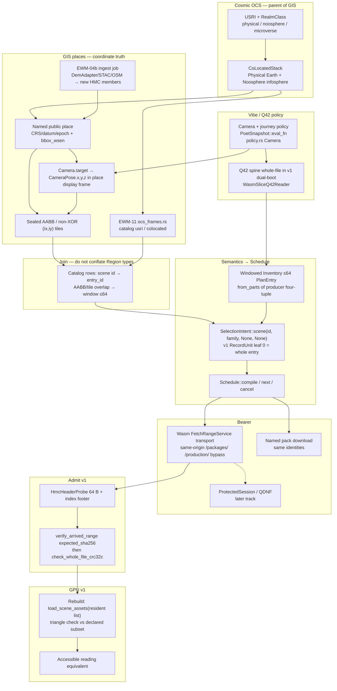
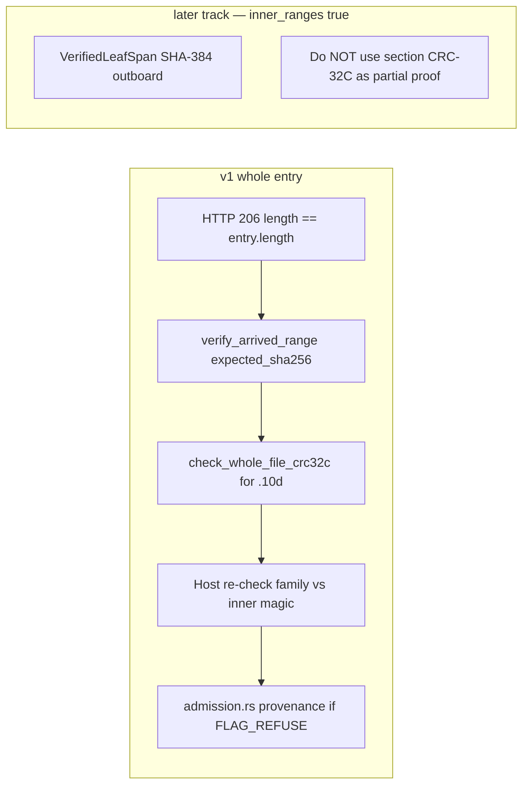
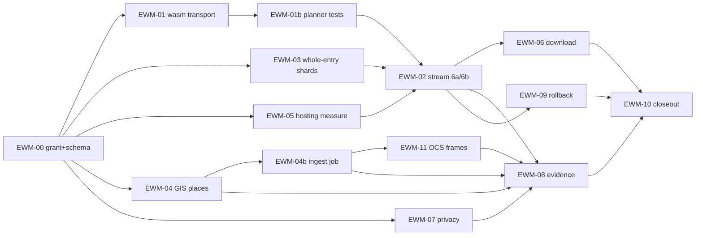

# Explorable world model: streamed and downloadable static assets

| Field | Value |
|---|---|
| Document | Explorable world model for webizen-website |
| Programme ID | EWM (Explorable World Model) |
| Author | Design agent (draft for review) |
| Date | 2026-11-17 |
| Locale | en-AU |
| Status | Draft (revision 4; owner decisions 2026-11-17 — cosmic/infosphere co-location + Timeline producer-only) |
| Relation | Specialised programme **beside** the AAA overhaul at `C:\github\webizen-website\plans\aaa-overhaul\`. Does not replace A00–A27. Related but insufficient: A06 (native population, streaming and interaction framework) and A14 (infosphere/QDNF streaming demos). **EWM-00 records an AAA path-lock grant before any `native/world-host` PR.** |

---

## Overview

The public webizen site currently boots a native living world by downloading every scene asset as a whole file. `native/world-host/src/runtime.rs` `bytes()` issues `fetch(path)` then `arrayBuffer()` with no `Range` header; `runtime/boot.rs` SHA-256s each complete `.10d`, admits it with whole-file CRC-32C, and uploads the lot through `QualiaPortal::load_scene_assets`. The served lush-woodland pack is **77** desktop assets totalling **58,637,584** bytes and **76** mobile assets totalling **47,166,968** bytes. That is already too large for a first paint that feels like an explorable world, and it will not scale to catchment, Earth, anatomy or infosphere extents without gigabyte downloads.

This programme makes the public site an explorable world model that **streams** QBDL-profile HMC members on demand, while still offering **downloadable static packs** that carry the same content-addressed identities. **Coordinate truth is GIS under cosmic OCS:** named public places with a declared CRS/datum/epoch sit in Physical Earth WGS84, which itself sits under the Omniversal Coordinate System already in QualiaDB/Poet (`vibe::cosmic`, OCS v2.2.0). The infosphere is a **co-located Noosphere layer** on those Earth places (cyber-space associated with people and works in public places), not a second planet and not a new `RealmClass`. Q42 is the **knowledge volume** for a place (what this landscape is, labels, relationships) fetched whole in v1; GIS datasets supply measured ground. The public development-path narrative is the existing sanitised `webizen.journey/v1` seven chapters; operator Timeline.json stays a local producer input and is never copied into the repo. Underlying Q42 descriptor inventory feeds QualiaDB’s existing `Schedule` planner in **windows of ≤64 live entries**. Inside a named place, camera motion selects among sealed catalog AABBs / non-XOR 100 m tiles. Navigation to another named place, or an explicit “load this public dataset” action, runs a bounded consent-gated **ingest job** that packs new HMC members. The website remains native Rust/WASM: generated wasm-bindgen loader only; no authored JavaScript scene, camera, scheduler or GIS query.

The v1 bearer is **HTTP Range on immutable static QBDL/HMC objects** (Cloudflare Worker Static Assets project `webizen`, GitHub Pages `_site` as fallback). Do not wait for wasm QDNF `ProtectedSession`. Transport is a **new wasm32 async module** in qualiaDB; admit uses existing `HmcProgressiveRangePlanner` / `verify_arrived_range` for **whole-entry SHA-256 only**. Inner ranges (`VerifiedLeafSpan`, section CRC-32C, `TenDDirectoryView` payloads) are **out of v1** (`inner_ranges: false`).

---

## Background & Motivation

### Current boot path (verified in source)

Living-world boot lives in `C:\github\webizen-website\native\world-host\`:

1. `lib.rs` `#[wasm_bindgen(start)]` spawns `runtime::boot()`.
2. `boot.rs` fetches `/world/living-world.vibe` (512 KiB cap), `/pkg/native-world/runtime-identity.json`, `/publication/current.json`, then the whole Q42 volume (16 MiB cap) and SHA-256s it against the pointer.
3. `graph.rs` opens the volume with `WasmSliceQ42Reader` (unified Q42VOL v4, 20,000 quin cap).
4. Vibe `world_settings` owns camera, lighting, sky, water and marker policy via `policy::evaluate` → `PoetSnapshot::eval_fn`. `policy::Camera` is `{yaw, pitch, zoom, target:[f32;3]}`.
5. Scene URL: if WebGL2 or `max-width: 900px` **and** the canvas has `data-scene-mobile`, use that attribute (homepage fallback string in the mobile branch is `/production/lush-woodland/scene.json` only if the attribute is empty). Otherwise use `data-scene`, falling back to **`/production/native-world/scene.json`**. The public homepage (`site/index.html`) sets `data-scene="/production/lush-woodland/scene.json"` and `data-scene-mobile="/production/lush-woodland/scene-mobile.json"`.
6. Every `scene.assets[]` is fetched whole (`bytes(url, 64 MiB)`), hashed, admitted (`admission.rs` `check_whole_file_crc32c` + provenance when `FLAG_DEFAULT_DISPOSITION_REFUSE`), texture-verified, then uploaded.
7. Caps: 64 MiB per asset, 256 MiB total, 512 assets, 16 MiB Q42. GPU admission fails closed if `index_count != authored_triangles * 3` (`boot.rs` lines 215–217) against the **full** scene, and offers the reading view.
8. Instancing is GPU-side (`runtime/instances.rs`, 10,000 source-record cap). Near/mid woodland LoD is **authored into the pack**, not pulled on demand (`scene.json` `woodland_lod`: near `prototype-eucalyptus-lush-near`, mid `prototype-eucalyptus-lush-mid`).

`runtime.rs` `bytes()` (lines 110–124) is same-origin whole-file fetch and **does not** consult `NetworkDisclosureRegistry`. `web-sys` already lists `Request`, `RequestInit`, `RequestMode`; `instruments/production.rs` uses `RequestInit` for POST `/api/produce`. Range is unused. Query parsing today only tests `gpu-timing=1`; `ewm=1` must be an **independent** token in the same `split('&')` loop.

### Served habitat numbers (lush-woodland)

From `production/lush-woodland/scene.json` and `scene-mobile.json` `totals`:

| Metric | Desktop `scene.json` | Mobile `scene-mobile.json` |
|---|---:|---:|
| Assets | 77 | **76** |
| Bytes | 58,637,584 | 47,166,968 |
| Vertices | 258,458 | **170,178** |
| Triangles | 440,626 | **309,098** |
| Ecology placements | 889 | **230** |
| Native instance records | 957 | **298** |
| Expanded triangles | 7,593,414 | **1,646,594** |

WASM identity (`site/pkg/native-world/runtime-identity.json`): `webizen_world_bg.wasm` **21,625,218 bytes (20.63 MiB)**, SHA-256 `3a8e81600174aa975f5000b694a081accfc5d3e5c2f5214d67d1327cf37f5304`. Host crate: `qualia-core-db` `default-features=false, features=["portal"]` only. `portal` already enables `wasm-scientific` / `gpu-runtime`; GIS **types** (planner, A5, quadtree) are already in this binary. Size risk is new call sites and DEM/PNG decode, not “compiling the planner”.

### Hosting constraints (verified)

- Cloudflare Worker Static Assets project **`webizen`**, `wrangler.jsonc` `assets.directory: ./_site`, custom domains `webizen.au` / `www.webizen.au`. **One owner for `wrangler.jsonc`: EWM-05.**
- `tooling/build_pages.py` `MAX_ASSET_BYTES = 25 * 1024 * 1024`. Files over 25 MiB are unlinked after copy. Comment: “Cloudflare Workers static assets reject files over 25 MiB.”
- `_site/_headers` (assembled by `build_pages.py`): COOP/COEP/CORP, nosniff; `/*.wasm`, `/*.10d`, `/*.q42` are `Cache-Control: public, max-age=31536000, immutable`. **No `Accept-Ranges`.** No `/*.hmc`.
- GitHub Pages also serves `_site` (`.github/workflows/pages.yml`) under subpath **`/webizen-website/`**. Local `world_server.py` maps `/production/` and `/publication/`.
- WASM 20.63 MiB sits ~4.38 MiB under the 25 MiB per-file cap. CI budget **23.5 MiB** (24,641,536 bytes) leaves ~2.87 MiB of allowed growth and ~1.5 MiB remaining under the Cloudflare cap after that budget.

### QualiaDB streaming (QBDL-profile HMC, not ZIP)

Normative: `C:\github\qualiaDB\docs\manuals\standards\hmc-container-format.md`.

- QBDL concatenates intact inner files and appends a CBOR index. An entry slice is byte-identical to the standalone inner file.
- Range-addressable: 64-byte header, then index footer, then selected entries. Inner range maps to `entry.offset + inner.offset`.
- **QBDL does not itself supply a dependency scheduler.** That is `Schedule` in `crates/qualia-core-db/src/bundle/stream/plan/` (`MAX_PLAN_ENTRIES = 64`, `MAX_SCHEDULE_ITEMS = 64`).
- Existing **progressive range planner** (LOD tiers, not a dependency graph): `HmcProgressiveRangePlanner`, `HmcRangeRequest`, `verify_arrived_range` in `bundle/streaming_loader.rs`; `HmcPackStreamer` in `bundle/streaming_hydration.rs`. Whole-entry requests carry `expected_sha256`. Interior `.10d` section requests carry **CRC-32C** (`expected_crc32c`). **v1 must not treat section CRC-32C as authentication of partial inner bytes** (CRC ≠ leaf proof, CRC ≠ entry SHA-256).
- ZIP `.hmc` is the legacy document-archive profile and is **not** a streaming target.
- Whole-file CRC-32C (header bytes `[36,40)`, `OFF_CRC32C = 36` in `bundle/format.rs`) cannot be verified from header/index alone. Entry SHA-256 authenticates only after all bytes of that entry are present.
- Planner `Region` is a **leaf index range** (`u64` start/end), **not** lon/lat. `LEAF_BYTES = 16_384`. Families: `TenD | Q42 | Emf | Qac | M64 | P64 | Opaque`. `Schedule::compile` / `next` / `cancel` / `acknowledge_complete`. `close_selection` enqueues **one** `RecordUnit` (a leaf; default **0** when `planner_region` is null). Control is never starved; M64/P64 wait while Ready live families remain.
- HTTP C5 mixed + Q42 authenticated range exist (`bundle/stream/http/`). `LEGACY_FULL_OBJECT_FALLBACK_BYTES = 1 << 20` (1 MiB). `Q42AuthenticatedRangeSource` + `Q42RangeVolume` when a span covers the query. Do **not** wrap `q42/volume` `HttpRangeSource` (native-only, blocking reqwest, never accepts 200 fallback). Partial ranges must not silently claim a complete query.
- `net/mod.rs` **omits** `mod fetch_10d` on wasm32. The `"Blocking HTTP range fetch unsupported on wasm32"` arm in `fetch_10d.rs` is **dead**. v1 adds a **new** async module rather than compiling the blocking one. **Wave 3 left browser/WASM out.** Claiming browser streaming exists would be false.

`CandidateIdentity` (`bundle/stream/descriptor/types.rs`) is `{descriptor: StrongDigest, context: StrongDigest, generation: u64, entries: u32}` produced by `InventoryVerifier` (SHA-384 of descriptor body + context). It is not a single hex field. `PlanEntry::key()` is `EntryRef`, not a filename.

### QualiaDB GIS (present, unused by world-host)

World-host does **not** call `SceneStreamingPlanner`, `query_region`, or `fetch_region_*`. Proof-lab Earth (`runtime/instruments/science.rs`) is a typed WGS84 lat/lon form (defaults −35, 149, 600 m), not camera-driven. The **existing public GIS terrain** is the Canberra public-reference DEM ingested by `native/data-pack-builder` (`data-pack.exe dem`, bbox WSEN `(149.06, -35.30, 149.08, -35.28)`, zoom 13, four Terrarium tiles, elevation 541–677 m, `not_personal_campsite: true`). Published display model: `canberra-reference-terrain` at `data/publications/aaa/terrain-model-v2/reference-terrain-model.10d` (**1,946,992** bytes, SHA-256 `bb895e81beaa7fc65804b6294e44d7fc334c1277baec8bbd025db287b7e665de`), 1:30 Y-up. Rejected ocean-tile acquisition at `data/acquisition/aaa/canberra-reference` is not a published dataset. Lush-woodland `habitat-terrain` is **authored artwork** (`epistemic_class: authored-artwork`; “fictional catchment, not measured land cover”) and is a field-studio mesh **in** that public locality, not a substitute for the DEM.

Existing APIs to reuse, not fork:

| API | Path | What it actually is |
|---|---|---|
| `query_region` | `domains/geospatial/canvas_query.rs` → `spatial.rs` | Spatiotemporal quadtree, bbox + time → H3/cell ids. Requires `index_asset` population. **Deferred in v1.** |
| `SceneStreamingPlanner::plan_stream` | `domains/geospatial/streaming.rs` | Camera pose → frustum tiles + VRAM **tile-id** eviction. `point_to_tile_id` is `floor(x/100) XOR floor(y/100) XOR floor(z/100)` — **collisions possible; not a catalog key**. |
| `LocationTriggerEngine::on_enter(location_hash, arena_quins)` | `domains/geospatial/triggers.rs` | Region hash → Q42 rule quins |
| `requires_micro_transition` | `domains/geospatial/scale_continuum.rs` | Camera scale vs `ReferenceFrame` (>1000× → child frame) |
| `lonlat_to_a5` / `a5_to_lonlat` | `domains/geospatial/geodesy/dggs_rtree_hot.rs` | A5 pentagonal DGGS, resolution 0..=15. **Deferred in v1** until a tree builder exists. |
| `build_packed_hilbert_index` / `query_bbox_hot` | same file | Packed Hilbert-ordered bbox search (`RTreeEntry`), zero-heap. **Deferred in v1.** |
| WGS84 Karney | `geodesy/wgs84_karney.rs` | Geodesy |
| `DemAdapter::fetch_region_dem` / `fetch_region_dem_async` | `adapters/dem_adapter.rs` | Consent-gated Terrarium PNG, zoom 15, 16 tiles, 16 MiB source cap. Wasm async exists. Not in public v1 binary call path. |
| `GbifAdapter::fetch_region` | `adapters/gbif_adapter.rs` | Builds request; **JSON parse of the live fetch path is still deferred**. `parse_features` exists separately. |
| `NetworkDisclosureRegistry` | `net/disclosure.rs` | Fail-closed egress consent by adapter id + URL prefix |
| `ResidencyGovernor::admit_or_evict_lru_zero_heap` | `render/gpu/residency_budget.rs` **re-exports** `etalon_resources::residency` | Policy/lifetime metadata. **Does not unload QualiaPortal meshes.** |

Public site must **never** publish exact campsite coordinates or raw Timeline data. Journey is broad regions/month bands only (`data/journey.json`).

### Why A06 and A14 are insufficient

- **A06** owns `native/world-host/**` and `world/runtime/**` for bounded instance/batch/LOD residency and camera controls. It does not specify QBDL Range, `Schedule`, GIS-to-entry join, 25 MiB shard strategy, or downloadable packs with shared identities.
- **A14** owns infosphere/QDNF demonstrations where mapped. QDNF `ProtectedSession` is native-service track, not the public static-asset bearer.
- AAA review: “Browser qualification, automatic LOD and streaming remain open.” Art review remains a separate gate.
- AAA A06/A02/A03 path locks currently **collide** with EWM writes. EWM-00 must land a recorded grant (see Key Decision 13) before any world-host PR.

### AAA exclusive trees (must handshake)

From `plans/aaa-overhaul/work-packages.json`:

| AAA | Exclusive paths | EWM collision if unamended |
|---|---|---|
| A00 | `plans/aaa-overhaul/**` | Only A00 may patch the lock file |
| A02 | `data/catalogue/**`, `data/acquisition/**`, `data/publications/**` | Do **not** put EWM GIS/consent there |
| A03 | `native/contracts/**`, `instruments/contracts/**`, `schemas/aaa/**` | Catalog lives in `schemas/ewm/**` (A03 does not own `schemas/ewm`) |
| A06 | `native/world-host/**`, `world/runtime/**` | Carve out EWM modules listed in the grant |

`native/contracts/` does not exist on disk today. Do not create it for EWM.

---

## Goals & Non-Goals

### Goals

1. Stream scene members so a visitor sees a coherent place without downloading the whole habitat (58.6 MiB desktop / 47.2 MiB mobile) or future gigabyte worlds.
2. Store assets in **QBDL-profile HMC** files (intact inner `.10d` `.q42` `.emf` `.qac` `.m64` `.p64` Vibe; content-addressed index; HTTP 206 of **whole entries** in v1).
3. Compile a **windowed** descriptor inventory (≤64 live `PlanEntry` / ≤64 `RecordUnit`) into `Schedule`, with a real `CandidateIdentity` via public `from_parts` copying a **producer-side** `InventoryVerifier` four-tuple. The browser does not run `InventoryVerifier`.
4. Model the world on **GIS places**. Slice 1 is one or more named public places (Canberra public-reference locality + lived lush-woodland field studio) with sealed GIS-derived terrain/knowledge. Camera motion inside a place uses AABB / non-XOR 100 m tiles over those sealed members. Moving to another named place, or an explicit dataset load, runs a bounded ingest job. A5 / `query_region` trees stay later.
5. Offer **downloadable static packs** of the same identities for offline/local-first use (download-to-disk / later OPFS on wasm; not `file://`).
6. Keep the current lush-woodland whole-file boot working until the streaming path is proven; fail closed to the reading view (`/publication/reading.html`).
7. Dispatch implementation as file-disjoint **EWM-00…** work packets, max 3 live specialists + 1 integrator, not colliding with A00–A27, **after** the AAA path-lock grant.

### Non-goals

- Replacing the AAA overhaul, A06 LOD/interaction work, or A14 infosphere demos.
- Authored JavaScript scene, camera, scheduler or GIS query implementation.
- Forking codecs; inventing HLS/DASH, WebTorrent, or a second dependency graph.
- Rewriting QBDL into an interleaved AV mux.
- ZIP `.hmc` streaming.
- Silently claiming a complete Q42 query from a partial range.
- Using `.10d` **section CRC-32C** as proof of partial inner bytes.
- Publishing precise personal location, raw Timeline, or non-Commons packs.
- Treating streaming success as visual/art acceptance.
- Pulling `ProtectedSession` or native sparse storage into the public WASM call path in v1. Live GBIF occurrence streaming in v1. Unbounded background GIS scrape. Putting DEM/PNG decode on the **default** wasm boot path (ingest jobs are explicit, consent-gated, and native-first so the 23.5 MiB wasm budget holds).
- Exploding `webizen_world_bg.wasm` past the 23.5 MiB CI budget / 25 MiB Cloudflare cap.
- Website-local `bytes_range` that reimplements fetch.
- Portal `unload_scene_parts` as a v1 requirement (PR10 is **not** required for v1).

---

## Key Decisions

1. **EWM is a specialised programme beside AAA, not a substitute.** A06 still owns generic LOD/instancing/interaction **outside** the carved EWM modules. Shared files (`boot.rs`, `runtime.rs`, `Cargo.toml`) stay with the EWM integrator while specialists write new modules.

2. **v1 bearer: HTTP Range on static QBDL/HMC.** Owner-confirmed 2026-11-17. Do not wait for wasm QDNF `ProtectedSession`. Same catalog identities serve Range and download. QDNF remains later-track.

3. **One catalog, two bearers.** Streaming Range and named pack download obtain the same entry SHA-256 / `CandidateIdentity`. Offline packs are not a second encoding.

4. **Do not conflate GIS region with planner `Region`.** Place identity and DEM extents are geodetic (declared CRS). Planner `Region` is a leaf index range. v1 never puts a GIS bbox into `SelectionIntent.region`. Camera-in-place selection uses catalog AABB / non-XOR `(ix, iy)` 100 m tiles in the place’s display frame.

5. **Two-phase GIS (owner 2026-11-17).** (1) **Named places, v1 first paint:** each place has sealed, Commons-permitted GIS members already in HMC (measured terrain, locality profile, Q42 about-this-landscape). Camera motion inside a place uses AABB / tiles over those sealed members — no unbounded live API. (2) **Navigation to other GIS:** moving to another named place, or an explicit “load this public dataset for this extent” action, runs existing consent-gated adapters (`DemAdapter::fetch_region_dem_async`, `StacAdapter`, `OsmAdapter`, …) as a **bounded ingest job**, then packs/admits new HMC members into the same catalog identities and schedules them. Fail-closed, attributed, not a silent background scrape. Live GBIF remains ingest/opt-in; `GbifAdapter::fetch_region` still defers JSON parse — v1 does not claim live occurrence streaming. Default-deny for `https://` GIS hosts until the visitor or a declared public demo ingest opts in. Same-origin `/packages/` `/production/` still use the PR1 bypass.

6. **Coordinate truth is GIS.** Owner: model the world on GIS so GIS datasets can provide terrain. Slice 1 is named public places with GIS identity + sealed GIS-derived terrain/knowledge; camera/place change pulls further GIS. The lush-woodland/campsite remains a **place** in that GIS world (lived field studio). Bind it to the already-ingested **Canberra public DEM window** (`bbox_wsen` 149.06, −35.30, 149.08, −35.28). Do not invent a private pin. Never publish exact campsite coordinates or raw Timeline. `habitat-terrain` stays labelled authored artwork; `canberra-reference-terrain` is the measured GIS ground for the same locality.

7. **Engine Range belongs in qualiaDB as a new wasm32 async transport.** `fetch_10d` is omitted on wasm (dead blocking arm). Do not compile the blocking module. Website must not reimplement fetch.

8. **v1 admits whole entries only.** HTTP 206 of `[entry.offset, entry.offset+length)` then `verify_arrived_range` against index SHA-256 then existing whole-file CRC-32C for `.10d`. Catalog flag `inner_ranges: false`. Section CRC-32C and `verify_leaf_span` are later-track. Whole-HMC CRC is unverified until a full-object download. Partial Q42 never answers as a complete query.

9. **WASM size budget: hard cap 23.5 MiB served wasm** (today **20.63 MiB** / 21,625,218 bytes; Cloudflare 25 MiB file cap). GIS types are already in `portal`. Do not put DEM/PNG decode on the default boot path. EWM-04b ingest is **native-first** (reuse `data-pack-builder` / `DemAdapter`); a public-page opt-in wasm ingest is allowed only if the budget still holds.

10. **Dual-boot until proven.** `ewm.streaming` defaults off. `ewm=1` is parsed independently of `gpu-timing=1`. Streaming failure → reading view.

11. **Art review is a separate gate.** Streaming residency ≠ visual acceptance (AAA G2/G3).

12. **ZIP HMC is not a streaming target.** Dispatch on `QBDL` magic, not `.hmc` extension.

13. **AAA path-lock handshake is a gate on EWM-00.** A00 (owner of `plans/aaa-overhaul/**`) merges a grant that: (a) narrows A06 `owned_paths` to exclude the EWM module list below **and** the EWM-integrator parents `native/world-host/src/runtime.rs`, `runtime/boot.rs`, `lib.rs`, `Cargo.toml` (A06 may read those four; writes go through the EWM integrator for the programme duration); (b) records that EWM catalog/contracts live in `schemas/ewm/**` not `native/contracts/**`; (c) records GIS/consent data under `data/ewm/**` not A02’s `data/publications/**` / `data/catalogue/**`. A06 keeps `world/runtime/**` and remaining non-stream world-host modules. No world-host PR before that grant is in the AAA lock file.

14. **Windowed `Schedule`.** Never compile all 77 assets into one `Inventory`. First paint and each camera-move window ≤64 entries / ≤64 units. v1 `RecordUnit { leaf: 0 }` with `region: None` means “fetch and admit the whole inner file”. **v1 does not run `InventoryVerifier` in the browser.** `CandidateIdentity` fields are `pub(crate)` with getters only (`descriptor/types.rs`); `webizen-world-host` is a separate crate and cannot write the struct literal. EWM-01b adds public `CandidateIdentity::from_parts(descriptor, context, generation, entries) -> Result<Self, DescriptorError>` that rejects zero digests (`StrongDigest::is_zero`). EWM-03’s **producer-side** (native) `InventoryVerifier` writes the four-tuple into the catalog; the host copies it via `from_parts` after hashing the catalog pointer. `Inventory::compile` does not require `entries.len() == candidate.entry_count()`, so a 10-id first-paint window compiles against a 78-entry candidate (77 woodland members + packed Canberra DEM). Shipping QASD body/pages as a ranged control-shard so the browser can call `finish()` is **out of v1**.

15. **GPU v1 = rebuild-from-resident-set.** Host keeps a resident list, calls `load_scene_assets` with that list, compares GPU counts to the **declared subset** (not `scene.triangle_count`). `ResidencyGovernor` does not unload portal meshes. PR10 (`unload_scene_parts`) is **not required for v1**.

16. **Adopt `HmcProgressiveRangePlanner` + `verify_arrived_range` for whole-entry SHA-256.** `Schedule` still owns dependency edges, `WorkClass`, cancel, and M64/P64 deferral (the progressive planner’s three LOD tiers are not a dependency graph). Reject `plan_10d_interior_section_ranges` / `expected_crc32c` as partial proof.

17. **Split identity pins.** Transport may check **shard** ETag/SHA. Complete-entry admit hashes the 206 body against **index `sha256`**. Never pass entry SHA into a partial-range fetch. HTTP 200 fallback only if `FallbackPolicy` is explicit **and** `body.len() ≤ 1 MiB` (`LEGACY_FULL_OBJECT_FALLBACK_BYTES`). Otherwise GET published whole-entry files as full objects.

18. **Family from inner magic.** Producer writes `EntryFamily` from inner magic/kind after packing. Host re-checks on admit and fails closed on mismatch with the catalog.

19. **Same-origin static is not live GIS egress.** `NetworkDisclosureRegistry::new()` is empty and `check_egress_consent` is fail-closed (`net/disclosure.rs`). **EWM-01 / PR1** implements the bypass inside `FetchRangeService::get_range`: if `endpoint` passes world-host `same_origin` rules (starts with `/`, not `//`, no `..`, no `\`) **and** starts with `/packages/` or `/production/`, skip the registry. Every other URL still requires `check_egress_consent`. PR6a first paint therefore works with an empty registry and **does not wait for EWM-07 / PR8**. EWM-07 still registers adapter `ewm_static` with those two prefixes (no `https://` GIS hosts) as the auditable catalog and keeps live adapters default-deny.

20. **Wasm offline is download-to-disk / later OPFS, not `file://`.** Native `fetch_10d` `file://` is not available on wasm.

21. **Cosmic OCS is the parent of GIS; infosphere is a co-located Noosphere layer.** Owner 2026-11-17: there is a cosmic coordinate system, and the infosphere is reflected as pseudo-layers in space (“cyber-space”) associated with reality and people in places on Earth. This already exists in QualiaDB/Poet. Do **not** invent a `cyber` `RealmClass`. Use OCS v2.2.0 `RealmClass::Noosphere` (`usri.rs`; G-COORD maps Noosphere/Phenomenology → `"viewpoint"`). The pseudo-layer primitive is `CoLocatedLayer` / `CoLocatedStack` (`colocated.rs`): layers share the same geodetic without collision; physical base USRI is `urn:omni:v1:physical:observable:standard:earth:wgs84`. Infosphere/cyberspace v1 = a Noosphere co-located layer on a Physical Earth place. `NestedRealm` (`nested.rs`, depth 0 = physical base) may nest a `Microverse` (anatomy) when `scale_continuum::requires_micro_transition` / `Cosmic.scale_factor` (`L-2`…`L12`) requires it. Knowledge about a place declares `GroundingStatus` (`grounding.rs`); collapse onto physical spacetime only when `EmpiricallyAnchored`. Cosmic `observer.rs` (observer fiber) is **not** website `entity_view::ObserverStatus` (Principal, Peer, Guardian, Steward, Public, Instrument, Auditor). Camera zoom is not a coordinate demonstration (AAA MASTER-PLAN). Scale changes invoke real frame transforms (`Cosmic.geodetic_to_ecef` / `ecef_to_enu` / `scale_factor`, `domains/geospatial` `ReferenceFrame`, website `proof.rs` `space()` already uses QualiaDB `geodetic` + `ephemeris_orbit`). RDF holograph (`render/rdf_holograph.rs`, portal `project_rdf_holograph`) is the infosphere **visual**; OCS co-location is the **coordinate contract**. Scheduler: `SelectionIntent` may request TenD/M64 (physical) and Q42 (noosphere) for the same public place identity — different HMC families, co-located, not one mashed mesh. Public infosphere may attach works, organisations, published identifiers to public places; it must not attach private persons, Timeline pins, or INFERRED_WORK/home. Use `entity_view` observer/circumstance for who may see what. Presentation label in en-AU: “infosphere”.

22. **Timeline.json is a local producer input; the public development path is `webizen.journey/v1`.** Owner: the operator Timeline export “is information that will be provided about the location of the development path of this software.” It is Google semantic-segments location history (visits, activities, precise points, `placeId`, `semanticType` including INFERRED_WORK). **Never copy it into webizen-website, git, `_site`, HMC, or Q42.** Existing `data/journey.json` already sanitises Nov 2025–Oct 2026 into seven broad artistic regions (`southern-tablelands`, `south-coast`, `high-country`, `riverina`, `central-victoria`, `western-slopes`, `northern-rivers`). Method: “A visit record is not a campsite.” `native/data-pack-builder/README.md`: no private Timeline in the public catalogue. v1 uses those seven chapters + Canberra public DEM + field studio. Adding 2013–2024 chapters is out of v1 unless a new **sanitised** journey record is authored. Infosphere co-location uses public place IRIs (`https://webizen.au/world/…`, `https://webizen.au/journey/…`), never Timeline points.

---

## Proposed Design

### Layer diagram



### Architectural split (confirmed)

| Layer | Responsibility | Non-responsibility |
|---|---|---|
| **HMC/QBDL** | Pack: intact inner files, content-addressed index, HTTP 206 of whole entries (v1) | Scheduler, GIS, HLS |
| **Semantics** | Windowed descriptor inventory compiled by `Schedule` | Lon/lat geometry; leaf ranges in v1 |
| **World Q42 + GIS** | Place identity; what to select; sealed AABB/tiles in a place; ingest job for other GIS | Transport; A5 tree in v1; live GBIF streaming |
| **Cosmic / OCS** | USRI, `RealmClass`, co-located Noosphere infosphere on Physical Earth; `GroundingStatus` | New `RealmClass`; warp/stardate/FLRW on the public boot path |
| **Infosphere visual** | Portal `rdf_holograph` / place markers for Q42 at the place identity | Private persons, Timeline pins, a second planet |
| **Downloadable static packs** | Same HMC identities as streamed entries | A second codec; wasm `file://` |

### AAA path-lock grant (EWM-00, applied by A00)

File: `plans/ewm/aaa-path-lock-grant.json` (EWM-owned draft). A00 merges the equivalent into `plans/aaa-overhaul/work-packages.json`.

A06 remaining exclusive after grant:

- `native/world-host/**` **except** the EWM exclusive modules **and** the integrator parents listed below
- `world/runtime/**` unchanged

EWM exclusive after grant:

| Path | Owner |
|---|---|
| `native/world-host/src/runtime/stream/**` except `flag.rs` | EWM-02 |
| `native/world-host/src/runtime/stream/flag.rs` | EWM-09 |
| `native/world-host/src/runtime/gis_join.rs` | EWM-04 |
| `native/world-host/src/runtime/gis_ingest.rs` | EWM-04b |
| `native/world-host/src/runtime/ocs_frames.rs` | EWM-11 |
| `native/world-host/src/runtime/consent.rs` | EWM-07 |
| `native/world-host/src/runtime/ui/download.rs` | EWM-06 |
| `schemas/ewm/**` | EWM-00 |
| `data/ewm/**` | split: GIS places `data/ewm/gis/places/**` (EWM-04); GIS ingest `data/ewm/gis/ingest/**` (EWM-04b); OCS frames `data/ewm/frames/**` (EWM-11); consent `data/ewm/consent/**` (EWM-07); first-paint fixture `data/ewm/first-paint.json` (EWM-00). **Never** `Timeline.json`. |
| `packages/qbdl/**` | EWM-03 |
| `packages/download/**` | EWM-06 |
| `packages/current.json` | EWM-10 |
| `plans/ewm/**` | EWM-00 |
| `wrangler.jsonc` | EWM-05 |

EWM-integrator exclusive for the programme duration (A06 may **read**; writes go through the EWM integrator):

| Path | Why |
|---|---|
| `native/world-host/src/runtime.rs` | Dual-boot `bytes()` / Range dispatch |
| `native/world-host/src/runtime/boot.rs` | Query parser, scene URL, GPU subset check |
| `native/world-host/src/lib.rs` | wasm start |
| `native/world-host/Cargo.toml` | `web-sys` / features |
| `qualiaDB/.../net/mod.rs` | `fetch_range_wasm` cfg export |
| `qualiaDB/.../bundle/streaming_loader.rs` | one-line `#[path]` for EWM-01b tests |
| `qualiaDB/.../bundle/stream/descriptor/types.rs` | `CandidateIdentity::from_parts` |

Until A00 merges the grant, **no EWM PR may edit `native/world-host/**`**.

### Static hosting design

#### Objects and URLs

Content-addressed, immutable:

```
/packages/by-sha256/<sha256>                 # raw inner file if < 24 MiB (Range-incapable host fallback)
/packages/qbdl/<pack-id>/<shard-sha256>.hmc  # QBDL shard (EWM-03)
/packages/download/<pack-id>.json            # named offline pack manifest (EWM-06)
```

Mutable pointers stay short-cache:

```
/publication/current.json                    # existing Q42 pointer
/packages/current.json                       # EWM catalog pointer (EWM-10)
```

Do not put gigabyte worlds in git. Shards must be **below** `MAX_ASSET_BYTES`.

#### Range behaviour (measurement gate, not an assumption)

`_headers` additions (assembled by `build_pages.py` `HEADERS`):

```
/*.hmc
  Content-Type: application/octet-stream
  Cache-Control: public, max-age=31536000, immutable
  Accept-Ranges: bytes

/*.10d
  … existing immutable …
  Accept-Ranges: bytes

/*.q42
  … existing immutable …
  Accept-Ranges: bytes
```

Client rules (C5 + split pins):

- Request `Range: bytes={start}-{end_inclusive}` and `If-Range` on the **shard** validator (object SHA/ETag).
- Accept **206** with exact length matching the requested entry.
- **200 fallback:** fail closed unless `FallbackPolicy` is explicit **and** `body.len() ≤ LEGACY_FULL_OBJECT_FALLBACK_BYTES` (1 MiB), then slice locally. An 8–11 MiB 200 body is **not** C5-legal to slice.
- Hosts that ignore Range must publish **whole-entry files** (already < 24 MiB; near prototype is 11,470,616 bytes) under `/packages/by-sha256/` or existing `/production/**/*.10d`. The client **GET**s them as full objects. Do not pretend 200-slicing of 8–11 MiB assets is C5.
- Never pass **entry** SHA-256 into a partial-range transport check.
- Multipart ranges rejected. Same-origin CORP. No third-party CDNs for v1.

EWM-05 **measures** 206 vs 200, `Content-Range`, `Accept-Ranges` on:

1. `https://webizen.au/` (Cloudflare Worker Static Assets)
2. `https://mediaprophet.github.io/webizen-website/` (GitHub Pages **subpath**; `build_pages.py` rewrites fetch URLs — Range headers should survive if the host honours them)
3. local `world_server.py`

Range support is a **gate**, not a claim. If a host cannot 206, that host uses whole-entry GET.

#### 25 MiB split strategy

| Object | Budget | Rule |
|---|---|---|
| `webizen_world_bg.wasm` | ≤ 23.5 MiB (24,641,536 B) | Hard fail CI if over; today 21,625,218 B |
| One QBDL shard | ≤ 24 MiB | Leave 1 MiB margin under CF cap |
| One inner entry | Hard 64 MiB host cap; near prototype 11,470,616 B | Whole-entry v1 |
| Catalog pointer | ≤ 64 KiB | |
| Named download pack | Shard list + assembler manifest | One 24 MiB shard at a time |

Lush-woodland 56 MiB desktop / 45 MiB mobile becomes **≥ 3 shards** plus a catalog. Semantic grouping (not round-robin):

1. **control** — catalog, Q42 pointer-sized metadata, instance tables that fit
2. **base** — first-paint ids (below)
3. **enhancement** — near prototype, remaining ecology, mid extras
4. **deferred** — M64/P64 if any (none required for woodland v1)

### First-paint membership (EWM-00 fixture)

8 MiB transferred is **not achievable** as a whole-entry v1 budget: authored `habitat-terrain` alone is **8,723,576** bytes and `prototype-eucalyptus-lush-near` is **11,470,616** bytes. Keep ≤8 MiB as a **later-track inner-range aspiration**.

The first place is the **Canberra public-reference locality** (journey chapter `southern-tablelands`) plus the lush-woodland field studio that sits in it. Two **different** ground identities, both first-paint, labelled in the catalog:

| id | bytes | epistemic class | role |
|---|---:|---|---|
| `canberra-reference-terrain` | 1,946,992 | measured GIS terrain | Public Canberra DEM window, bbox WSEN 149.06/−35.30/149.08/−35.28, WGS84, zoom-13 Terrarium, 541–677 m, `not_personal_campsite`. Display 1:30 Y-up. **Fetch** `/packages/by-sha256/bb895e81…65de` (EWM-03 copy into `/packages/` so PR1 same-origin bypass covers first paint). **Source** A02 publication `data/publications/aaa/terrain-model-v2/reference-terrain-model.10d` (read-only; SHA-256 `bb895e81…65de` unchanged). |
| `habitat-terrain` | 8,723,576 | authored-artwork | Vibe habitat material field; fictional catchment, **not** measured land cover (`scene.json` `epistemic_class`). Field-studio ground in the same named place. |
| `prototype-eucalyptus-lush-mid` | 1,036,928 | authored-artwork | Canopy stand-in (7 near instances wait for enhancement) |
| `car-passat-b7--gold` | 880,696 | authored-artwork | Campsite silhouette (no coordinates) |
| `car-passat-b7--glass` | 435,736 | authored-artwork | |
| `car-passat-b7--chrome` | 1,100,272 | authored-artwork | |
| `vintage-windup-camper--chassis` | 97,240 | authored-artwork | |
| `vintage-windup-camper--enamel` | 291,320 | authored-artwork | |
| `solar-array-three--panel` | 57,976 | authored-artwork | |
| `starlink-mini--dish-front` | 61,328 | authored-artwork | |
| **Sum** | **14,632,064 (~13.96 MiB)** | | **v1 first-paint budget ≤ 15 MiB** |

Authored-only subtotal remains 12,685,072. Enhancement (not first paint): `prototype-eucalyptus-lush-near` (11,470,616) + remaining campsite parts + ecology prototypes. Mobile uses the same **identities** present in `scene-mobile.json` (76 assets) plus the GIS terrain row; omit any authored id missing on mobile.

EWM-02 acceptance: `?ewm=1` must **not** fetch all 77 (desktop) / 76 (mobile) whole files. Test against this id list. Catalog rows must carry `epistemic_class` so measured DEM and authored habitat are never confused.

### Bootstrap sequence

Keep current whole-file boot behind `ewm.streaming=0`. Streaming boot (v1 whole-entry):

```mermaid
sequenceDiagram
  participant V as Vibe camera/journey
  participant H as world-host (Rust/WASM)
  participant C as Catalog pointer
  participant S as Schedule window ≤64
  participant B as FetchRangeService + HmcProgressiveRangePlanner
  participant G as QualiaPortal GPU

  H->>C: GET /packages/current.json (64 KiB) via existing bytes()
  Note over H: hash catalog pointer; copy candidate four-tuple
  H->>B: Range QBDL header 0-63 (FetchRangeService same-origin bypass)
  H->>B: Range index footer
  Note over H: HmcHeaderProbe; do not claim whole-file CRC
  H->>H: CandidateIdentity::from_parts (no browser InventoryVerifier)
  V->>H: world_settings camera
  H->>S: window first-paint ids into Inventory ≤64
  loop Schedule::next until first visible frame
    S->>B: next RecordUnit leaf 0 (whole entry)
    B->>H: 206 body
    H->>H: verify_arrived_range SHA-256 + admission::check
    H->>S: acknowledge_complete
  end
  H->>G: load_scene_assets(resident list)
  Note over G: triangle check vs declared subset
  G-->>H: first paint
  Note over S: delay M64/P64; near prototype is Enhancement
  V->>H: camera move (after GIS data + stream loop)
  H->>S: cancel + new window ≤64
```

Order (`WorkClass` in `plan/schedule.rs`):

1. Tiny scene descriptor — `/packages/current.json` + Vibe (existing `bytes()`, 512 KiB cap).
2. Q42 spine — **v1 keeps the existing whole-volume fetch** (16 MiB cap) for dual-boot graph decode. Inner Q42 ranges wait on `inner_ranges: true` (later). Do not claim a ranged complete query.
3. Control / metadata — QBDL header+index, descriptor inventory.
4. Visible base — first-paint id list (terrain, mid prototype, campsite silhouette).
5. Enhancement — near prototype and remaining ecology.
6. Deferred — `EntryFamily::M64 | P64`.
7. Cancel on camera move — `Schedule::cancel`; do not apply late bytes to a cancelled unit.

### Wasm range admission



Rules:

1. Whole-HMC CRC-32C is catalog metadata only while streaming.
2. Producer-side `InventoryVerifier` binds SHA-384 header+index+QASD body into `CandidateIdentity`. The host copies that four-tuple with `from_parts` after hashing the catalog pointer. Header probe is not admission. Browser `finish()` is out of v1.
3. Complete inner file: Range exact entry slice; `HmcRangeRequest.expected_sha256` only; `verify_arrived_range`; then `admission::check`.
4. v1 catalog `inner_ranges: false`. Host must not call `verify_leaf_span`, `plan_10d_interior_section_ranges`, or `TenDDirectoryView` payload admit.
5. Q42 in v1: whole knowledge volume via existing `bytes()` + `WasmSliceQ42Reader` (16 MiB cap). This is a single-visitor public site, not a multi-user sync fabric. Do not block v1 on a ≤1 MiB dedicated spine. Later: `Q42AuthenticatedRangeSource` + `Q42RangeVolume`; gap → `UnexpectedEof`.
6. Never wrap `HttpRangeSource`.
7. Reject `expected_crc32c` as authentication of partial inner bytes even if `HmcPackStreamer` offers it.

### GIS join (v1)

Coordinate truth is the **named public place** under cosmic OCS, not an unlocated metre sandbox.

```
Cosmic / OCS (USRI, celestial, FLRW, HEALPix)
  └─ Physical Earth WGS84 / ECEF / ENU (GIS DEM, hydrology, places)
       ├─ local habitat metres (authored field studio, Y-up)
       ├─ co-located Noosphere layer (infosphere / “cyber-space”: Q42 graph, identifiers, people-as-agents, works, claims)
       └─ nested Microverse (anatomy) when scale_factor requires it
```

| System | Origin | Units | v1 use |
|---|---|---|---|
| Cosmic USRI | `vibe::cosmic::usri` OCS v2.2.0 | URN | Place `usri` + `realm_class`; infosphere `noosphere` co-located layer |
| Geodetic place | WGS84 / declared CRS, `bbox_wsen`, epoch | degrees | Place identity, DEM extent, ingest bbox. First place: Canberra public reference `(149.06, -35.30, 149.08, -35.28)`. |
| Place display frame | ENU metres, `up: +Y` (DEM model is 1:30; authored habitat uses `scene.json` metres) | metres | Camera, GPU, catalog AABB / tiles **inside** the current place |
| Co-located infosphere | `CoLocatedLayer` sharing the place geodetic; `GroundingStatus::EmpiricallyAnchored` to public GIS/Q42 | same geodetic | Q42 family for the same `place_id`; RDF holograph visual |
| Planner `Region` | leaf index range | leaf | Never a lon/lat bbox |

Journey chapter `southern-tablelands` (“Southern Tablelands & Canberra region”) binds to this public locality via `https://webizen.au/journey/southern-tablelands`. A visit record is not a campsite. Do not publish exact campsite coordinates, Timeline points, `placeId`s, or INFERRED_WORK/home. The field studio (Passat, camper, solar, Starlink Mini) is the shared artistic setting, not a mapped campsite.

**Camera mapping (v1, specified):**

```text
policy::Camera { yaw, pitch, zoom, target:[x,y,z] }
        ↓
geospatial::CameraPose {
  x: target[0] as f64,
  y: target[1] as f64,
  z: target[2] as f64,
  yaw: yaw as f64,
  pitch: pitch as f64,
}
zoom is unused for pose (framing only; not height).
```

**Do not** use `point_to_tile_id` XOR as a catalog key.

v1 tile id stored in catalog:

```text
ix = floor(x / 100), iy = floor(z / 100)   # Y-up: horizontal plane is x/z
tile = (ix, iy) as a pair, not XOR
```

Each catalog row carries `place_id`, `epistemic_class` (`measured-gis` | `authored-artwork`), `aabb` in the place display frame, and `tiles: [[ix,iy], ...]`. Selection **inside a place** = AABB overlap with the camera target expanded by a Vibe-authored radius (default 80 m) **or** tile membership of `(floor(target.x/100), floor(target.z/100))`.

Window the overlapping entries to ≤64 (mandatory first, then nearest AABB, drop optional). `SelectionIntent.region` stays `None` in v1 (whole entry).

Q42 is the knowledge volume for the place (“about this landscape”). v1 fetches the existing whole Q42 file (`bytes()`, 16 MiB cap) so `graph.rs` `collect_all_quins` stays complete. Mapping predicates are **new** and need a named publication pass (EWM-04 data). `graph.rs` currently has `https://webizen.au/world/` and `https://webizen.au/relation/` but **no** `locatedIn` / `hmcEntry` predicates. Until that publication exists, the JSON catalog place/AABB/tile fields are the join.

`query_region` / `lonlat_to_a5` / `query_bbox_hot` require an in-memory tree. **Nobody populates that tree in v1.** Deferred.

EWM-04 in Wave 2 is **place catalog + AABB/tile data** (still no camera-move `SelectionIntent` until PR6a). Integrator wires `gis_join.rs` after PR6a. EWM-04b (same GIS specialist, sequential) is the **ingest helper**: native-first job that calls consent-gated adapters, writes `data/ewm/gis/ingest/**`, packs a new HMC member, and appends catalog rows. Wasm opt-in ingest is later and budget-gated. EWM-11 (same GIS specialist, sequential after EWM-04b) is **`ocs_frames.rs` + `data/ewm/frames/**`**: catalog `usri` / `realm_class` / `colocated` using existing `vibe::cosmic` types. Integrator wires after PR6a.

`SelectionIntent` for one public place may request TenD/M64 (physical) and Q42 (noosphere) in the same window — different HMC families co-located, not one mashed mesh.

**Wasm subset:** `webizen-world-host` already depends on `vibe` (`pub mod cosmic`) and portal (`rdf_holograph`, `geodetic`, `ephemeris_orbit`). v1 infosphere spatialisation reuses existing Q42 decode + portal `project_rdf_holograph` / place markers. `ocs_frames.rs` binds catalog USRI/co-location; it must **not** add warp/stardate/FLRW call sites on the public boot path. VibeScript `Cosmic.*` is post-0.1 **native-desktop** (`docs/manuals/standards/vibescript-core.md`). MCP `cosmic_coordinates` (`qualia-mcp/src/tools/living_cosmic.rs`) stays a producer/operator tool. If wasm would exceed 23.5 MiB, feature-gate unused Cosmic.* rather than growing the boot path. Camera `zoom` stays framing-only; scale changes that claim a frame shift must call real transforms (`Cosmic.scale_factor`, `ReferenceFrame`, ECEF).

**Privacy:** no geolocation API; journey month bands; no campsite pins; no Timeline.json in the repo. Public DEM bbox is the declared locality, not a private pin. Infosphere co-location uses public place IRIs only.

### GPU residency and eviction (v1)

`QualiaPortal::load_scene_assets` is an alias of `load_body_organs_colored`: it constructs a fresh `BodyMeshAccum`, appends every organ, and `finish_body_mesh_upload`s the combined mesh. It does **not** add or drop parts.

v1 algorithm (**rebuild-from-resident-set**):

1. Host `ResidentSet: Vec<AdmittedAsset>` (id, bytes, colour, placements).
2. On schedule complete: insert/replace in `ResidentSet`; on cancel/evict: remove.
3. Call `load_scene_assets` with the **current** resident array (full rebuild).
4. Triangle/vertex check against the **declared subset receipt**, not `scene.triangle_count` / `scene.vertex_count`.
5. If GPU `index_count != declared_subset_triangles * 3`, fail closed to reading view.
6. Instance bind (`instances.rs`) runs on the resident array only.

`ResidencyGovernor::admit_or_evict_lru_zero_heap` (Etalon re-export) may inform **which ids** to drop from `ResidentSet`. It does not unload portal meshes by itself.

Rebuild cost is accepted for v1 (first-paint ~9 meshes; later windows ≤64). PR10 `unload_scene_parts` is **not required**. If rebuild is later measured unacceptable, that is a **new** engine PR, not a silent EWM-02 scope.

Receipt: `webizen.native-world-receipt/v1` plus `streaming: {mode, resident_entry_ids, declared_triangles, declared_vertices, bytes, cancelled, inner_ranges:false}`.

### Downloadable static packs

- Catalog lists `pack_id`, title, bytes, shard list, entry SHA-256s, licence, accessibility description.
- Download UX (`runtime/ui/download.rs`): sequential shard fetch + SHA-256 verify; same identities as streaming.
- Wasm offline: browser download-to-disk and, later, OPFS via QualiaDB — **not** `file://` (`std::fs` in native `fetch_10d` is unavailable).
- Reading view always available without the pack.

### Dual-boot, flags, and query parsing

`runtime::fail` already points `#native-fallback` at `/publication/reading.html`.

Query parser (integrator, `boot.rs`; independent tokens):

```rust
let mut gpu_timing = false;
let mut ewm = false;
for p in query.trim_start_matches('?').split('&') {
    if p == "gpu-timing=1" { gpu_timing = true; }
    if p == "ewm=1" { ewm = true; }
}
```

Flag sources for **enabling** streaming (OR, not first-match-wins across kinds): `ewm=1` **or** `canvas[data-ewm-streaming="1"]` **or** catalog `streaming.default==true`. Production default **false** until EWM-08 + user accept. EWM-00 schema defines this; EWM-09 owns `flag.rs` as the production helper. PR6a **reads** query + catalog + data-attribute inline and must not create `flag.rs`.

Whole-file `bytes()` remains for Vibe, identity JSON, dual-boot Q42, and catalog pointer. **All Range calls go through QualiaDB `FetchRangeService` once PR1 exists.** No website `bytes_range`. PR6a must not wait for `consent.rs` / PR8: the PR1 same-origin prefix bypass is the first-paint consent path. Empty-registry must not be a possible state of a green `?ewm=1` build for `/packages/` and `/production/`.

### WASM / crate feature budget

Do **not** enable `wasm-full`, `wasm-llm`, or `bundle/stream/protection` (`cfg(not(wasm32))`). Do **not** compile `net/fetch_10d` on wasm.

Add in qualiaDB:

- `net/fetch_range_wasm.rs` (NEW), `cfg(target_arch = "wasm32")`, web-sys `fetch` + `Range`.
- **Same-origin bypass in the transport (PR1, not PR8):** `get_range` skips `NetworkDisclosureRegistry` when `endpoint` is a same-origin path (`starts_with('/')`, not `'//'`, no `'..'`, no `'\\'`) that starts with `/packages/` or `/production/`. Empty registry cannot black-hole PR6a. Live GIS (`https://`, other prefixes) still fail-closed via `check_egress_consent`.
- Returns raw 206/200 bytes. Admit is `verify_arrived_range` / existing `admission.rs`, not the transport.

World-host stays `features=["portal"]`. GIS adapters (PNG/HTTP) stay out of the public **call path**.

CI records wasm bytes vs 23.5 MiB. EWM-01 handoff includes wasm size delta.

---

## API / Interface Changes

### QualiaDB (engine)

Wasm transport only (no admit, no object-SHA on partial ranges):

```rust
// crates/qualia-core-db/src/net/fetch_range_wasm.rs  (NEW, wasm32 only)
pub struct FetchRangeService;

impl FetchRangeService {
    /// Raw HTTP GET with Range. Does not hash the slice as an entry.
    /// optional_shard_etag pins the object, not the inner entry.
    pub async fn get_range(
        &self,
        endpoint: &str,           // path; engine re-checks same_origin + prefix
        offset: u64,
        length: u64,
        optional_shard_etag: Option<&str>,
        registry: &NetworkDisclosureRegistry,
        adapter_id: &str,         // used only when the same-origin prefix bypass does not apply
    ) -> Result<FetchedRange, String>;
}

pub struct FetchedRange {
    pub status: u16,              // 206 or 200
    pub bytes: Vec<u8>,
}
```

`get_range` consent order (PR1, required for a green `?ewm=1` with empty registry):

1. If `endpoint` is a same-origin path (world-host `same_origin` rules) **and** starts with `/packages/` or `/production/` → allow (do not call `check_egress_consent`).
2. Else if `registry.check_egress_consent(adapter_id, endpoint)` → allow.
3. Else fail closed.

200 with `bytes.len() > LEGACY_FULL_OBJECT_FALLBACK_BYTES` is an error unless the request was a **full-object GET** (`offset==0 && length==object_len`). Hosts that cannot Range are called with full-object GET of a **published whole-entry URL**, not a shard slice.

Public constructor (EWM-01b, integrator edit to `descriptor/types.rs`; website cannot write the `pub(crate)` struct literal):

```rust
impl CandidateIdentity {
    /// Copy a producer-side InventoryVerifier identity. Not trusted authority.
    /// Rejects zero descriptor or context digests (`StrongDigest::is_zero`).
    pub fn from_parts(
        descriptor: StrongDigest,
        context: StrongDigest,
        generation: u64,
        entries: u32,
    ) -> Result<Self, DescriptorError> { /* Field on zero digest */ }
}
```

Host construction path (PR6a/6b): hash `/packages/current.json` → decode 96-hex SHA-384 fields with `StrongDigest::from_bytes` → `CandidateIdentity::from_parts` → `PlanEntrySpec.candidate` → windowed `Inventory::compile`. **Do not** call `InventoryVerifier::new` / `finish` in wasm (`finish` requires a QASD `BodyView`, `seal_contexts`, and every entry-page bit; header+index Range is not that body).

Reuse: `HmcHeaderProbe`, `HmcProgressiveRangePlanner::plan_entry_ranges`, `verify_arrived_range` (**SHA-256 whole entry only**), `Schedule`. `InventoryVerifier` is **producer-side only** in v1.

**No** `unload_scene_parts` in v1. **No** website `bytes_range`.

Do not change EMF/QAC codecs, etalon-render, or ZIP HMC.

### Website host

Keep `bytes()` for non-Range dual-boot fetches.

New modules (file-disjoint):

| Module | Owner | Role |
|---|---|---|
| `runtime/stream/mod.rs` | EWM-02 | Windowed Schedule loop, cancel, resident set, rebuild GPU |
| `runtime/stream/catalog.rs` | EWM-02 | Parse `webizen.ewm-catalog/v1` |
| `runtime/stream/admit.rs` | EWM-02 | `verify_arrived_range` + `admission::check` + family re-check |
| `runtime/stream/flag.rs` | EWM-09 | Production flag helper (not in PR6) |
| `runtime/gis_join.rs` | EWM-04 | Place AABB/tile overlap; no A5 tree |
| `runtime/gis_ingest.rs` | EWM-04b | Native ingest job → catalog + HMC member |
| `runtime/ocs_frames.rs` | EWM-11 | USRI / `RealmClass` / `CoLocatedStack`; infosphere Noosphere layer |
| `runtime/consent.rs` | EWM-07 | `ewm_static` + live GIS deny; opt-in ingest prefixes |
| `runtime/ui/download.rs` | EWM-06 | Named packs |

`web-sys` features to add (integrator, with PR6a): `Headers`, `AbortController`, `AbortSignal`.

### Catalog schema (`schemas/ewm/catalog.v1.json`)

`webizen.ewm-catalog/v1`:

```json
{
  "schema": "webizen.ewm-catalog/v1",
  "pack_id": "canberra-public-place",
  "inner_ranges": false,
  "places": [
    {
      "id": "canberra-public-reference",
      "title": "Southern Tablelands & Canberra region (public reference)",
      "journey_chapter": "southern-tablelands",
      "not_personal_campsite": true,
      "crs": "EPSG:4326",
      "datum": "WGS84",
      "bbox_wsen": [149.06, -35.30, 149.08, -35.28],
      "dem_zoom": 13,
      "elevation_m": [541, 677],
      "gis_terrain_id": "canberra-reference-terrain",
      "authored_ground_id": "habitat-terrain",
      "usri": "urn:omni:v1:physical:observable:standard:earth:wgs84",
      "realm_class": "physical",
      "colocated": [
        {
          "id": "canberra-public-infosphere",
          "label": "infosphere",
          "realm_class": "noosphere",
          "usri": "urn:omni:v1:noosphere:webizen:public:world/canberra-public-reference",
          "grounding": "EmpiricallyAnchored",
          "anchor_iri": "https://webizen.au/world/canberra-public-reference",
          "journey_iri": "https://webizen.au/journey/southern-tablelands",
          "families": ["Q42"]
        }
      ]
    }
  ],
  "candidate": {
    "descriptor_sha384": "<96 hex>",
    "context_sha384": "<96 hex>",
    "generation": 1,
    "entries": 78
  },
  "shards": [
    {
      "id": "base",
      "url": "/packages/qbdl/lush-woodland/<shard-sha256>.hmc",
      "sha256": "<64 hex>",
      "bytes": 16000000,
      "crc32c": "<8 hex>",
      "etag": "\"<shard-sha256>\""
    }
  ],
  "first_paint": [
    "canberra-reference-terrain",
    "habitat-terrain",
    "prototype-eucalyptus-lush-mid",
    "car-passat-b7--gold",
    "car-passat-b7--glass",
    "car-passat-b7--chrome",
    "vintage-windup-camper--chassis",
    "vintage-windup-camper--enamel",
    "solar-array-three--panel",
    "starlink-mini--dish-front"
  ],
  "entries": [
    {
      "entry_id": 1,
      "scene_id": "canberra-reference-terrain",
      "place_id": "canberra-public-reference",
      "epistemic_class": "measured-gis",
      "family": "TenD",
      "family_from": "inner-magic",
      "role": "Base",
      "obligation": "Mandatory",
      "sha256": "bb895e81beaa7fc65804b6294e44d7fc334c1277baec8bbd025db287b7e665de",
      "bytes": 1946992,
      "url": "/packages/by-sha256/bb895e81beaa7fc65804b6294e44d7fc334c1277baec8bbd025db287b7e665de",
      "source_publication": "data/publications/aaa/terrain-model-v2/reference-terrain-model.10d",
      "shard": "base",
      "aabb": {"min": [-40, 0, -40], "max": [40, 20, 40]},
      "tiles": [[-1, -1], [0, 0]],
      "planner_region": null
    },
    {
      "entry_id": 2,
      "scene_id": "habitat-terrain",
      "place_id": "canberra-public-reference",
      "epistemic_class": "authored-artwork",
      "family": "TenD",
      "family_from": "inner-magic",
      "role": "Base",
      "obligation": "Mandatory",
      "sha256": "0d71982db5c21d05a068e9188f7a823670cbadb500f0af5015fdbb008a032d21",
      "bytes": 8723576,
      "shard": "base",
      "aabb": {"min": [-80, 0, -80], "max": [80, 40, 80]},
      "tiles": [[-1, -1], [0, 0]],
      "planner_region": null
    }
  ],
  "edges": [{"from_entry_id": 2, "to_entry_id": 1, "reason": "Geometry", "obligation": "Mandatory"}],
  "streaming_default": false
}
```

The four-tuple is a **copy** of a producer-side `InventoryVerifier::finish()` identity, not a construction path by itself. `webizen-world-host` cannot write `CandidateIdentity { .. }` (`pub(crate)` fields, separate crate). Bind via `CandidateIdentity::from_parts` after `StrongDigest::from_bytes` on the 48-byte SHA-384 fields. Window `entries` to the live set before `Inventory::compile` (`compile` does not require `entries.len() == candidate.entry_count()`). `planner_region: null` ⇒ `SelectionIntent` region `None` ⇒ `RecordUnit::at(0)` ⇒ whole inner file. `scene_id` maps `scene.json` `id` to QBDL `entry_id`. Single-hex `candidate_sha384` is rejected by the schema.

Producer writes `family` from inner magic after packing; host fails closed if admit-time family ≠ catalog.

---

## Data Model Changes

### Q42

EWM-04 may add mapping quins under `https://webizen.au/relation/` **only after** a named publication pass. Until then the JSON catalog is authoritative for AABB/tiles. No campsite coordinates. Do not extend A02 `data/publications/**`.

### HMC production

Repack lush-woodland loose `.10d` into QBDL shards with QualiaDB `bundle/writer.rs` `BundleWriter` (intact files, insertion-order index). Optional Synth save path is `synth/src/host_package.rs` (`#[path]` from `host.rs`) `SynthHost::save_candidate` — **not** `synth/src/production/package.rs` (that path does not exist). Inner bytes unchanged so `scene.json` SHA-256s remain valid.

EWM-03 also **copies** the published Canberra DEM (`data/publications/aaa/terrain-model-v2/reference-terrain-model.10d`, SHA-256 `bb895e81…65de`) into `/packages/qbdl` base and `/packages/by-sha256/<sha256>`. A02 `data/publications/**` stays read-only. First-paint fetch URLs stay under `/packages/` so the PR1 same-origin bypass covers the measured GIS ground. Catalog rows record `source_publication` for provenance. Dual-boot still uses the 77-asset woodland `scene.json`; the streaming catalog is 78 packed members (those 77 plus the DEM).

EWM-03 **native** pack helper runs `InventoryVerifier` (QASD `BodyView` + context/entry pages) and writes `finish()` into the catalog four-tuple. That QASD body is a **producer artefact**; v1 does **not** ship it as a ranged control-shard for the browser to re-verify. The host trusts the catalog pointer hash + `from_parts`.

EWM-03 acceptance: **whole-entry shards only**; `inner_ranges: false`; outboard **optional and not required**. Machine-readable `scene_id` → `entry_id` map in the catalog.

Dual-publish loose `.10d` and QBDL shards until EWM-09. Do not delete loose files in the first production PR.

### Hosting

`build_pages.py` mounts `/packages/`. `_headers` gains `/*.hmc` and `Accept-Ranges`.

---

## Alternatives Considered

### 1. Whole-file boot forever, just fewer assets

- **For:** No engine work; wasm unchanged.
- **Against:** 56 MiB for one clearing; AAA calls streaming open. Rejected as the product path; retained as **rollback**.

### 2. Full QDNF `ProtectedSession` in the browser for v1

- **For:** One native service model, leaf proofs.
- **Against:** Wave 3 excluded browser/WASM; `protection` is native-only; wasm size. **Later track.**

### 3. HLS/DASH or WebTorrent of interleaved media

- **Against:** Forbidden. Rejected.

### 4. One 56 MiB HMC and hope Range works

- **Against:** Cloudflare 25 MiB per-file cap. Must shard.

### 5. Live GBIF/DEM from the public page as the GIS path

- **Against as default boot:** Consent, wasm size, deferred GBIF parse, privacy.
- **Decision:** Named sealed places for first paint. Further GIS is an explicit ingest job (EWM-04b), not a silent camera-tick scrape. Live GBIF parse remains deferred.

### 6. Reuse `HmcProgressiveRangePlanner` as the only scheduler

- **For:** Already in tree; `plan_entry_ranges` + `verify_arrived_range` match v1 whole-entry SHA-256; three LOD tiers resemble first-paint/enhancement.
- **Against:** Tiers classify by **key/kind strings**, not `DependencyEdge` / `WorkClass` / cancel / M64 deferral / ≤64 window. Interior path uses **section CRC-32C**, which this design **rejects** as partial proof.
- **Decision:** Adopt the planner **for whole-entry range lists and SHA-256 verify**. Keep `Schedule` for dependency-aware windows, cancel, and family deferral. Do not call `plan_10d_interior_section_ranges` in v1.

---

## Security & Privacy Considerations

| Threat | Severity | Mitigation |
|---|---|---|
| Mixed-version Range concatenation | High | Shard ETag/`If-Range`; identity error on mismatch |
| Partial Q42 presented as complete | High | v1 whole spine only; later gap → `UnexpectedEof` |
| Section CRC trusted as partial proof | High | `inner_ranges: false`; never set `expected_crc32c` in v1 |
| Unauthenticated inner bytes via entry hash | High | v1 whole entries only; entry SHA never on a partial fetch |
| Path traversal | High | Existing `same_origin()` |
| Wasm / HMC over 25 MiB dropped | Medium | CI 23.5 MiB; shards < 24 MiB |
| Precise personal location leak | High | No geolocation; journey month bands; no campsite pins; Timeline.json never in repo/`_site`/HMC/Q42 |
| Timeline `placeId` / INFERRED_WORK / home published | High | Producer sanitiser emits only `webizen.journey/v1` chapter ids and month bands; public GIS extents are declared localities (Canberra DEM window), not pins |
| Infosphere attaching private persons | High | Public place IRIs only; `entity_view` observer/circumstance; no Timeline points as graph nodes |
| Invented `cyber` RealmClass | Medium | Use existing `RealmClass::Noosphere`; en-AU label “infosphere” |
| Live GIS egress without consent | High | Live adapters default-deny; ingest job requires opt-in; `ewm_static` prefixes only `/packages/` and `/production/` |
| Silent GIS scrape on camera tick | High | Inside a place: sealed members only. Other GIS: named ingest job |
| Authored habitat passed off as measured DEM | High | Catalog `epistemic_class`; `habitat-terrain` vs `canberra-reference-terrain` |
| Campsite pin leaked via “GIS origin” | High | Bind to public Canberra bbox only; journey month bands |
| Empty registry black-holes first paint | High | PR1 `get_range` bypass for same-origin `/packages/` and `/production/`; PR8 is audit, not a first-paint gate |
| COEP/CORP break | Medium | Keep same-origin `_site` |
| Non-Commons data in packs | Medium | Catalog licences; provenance flag unchanged |

TLS/Web PKI is not PQ publisher authority (`tls_is_pq_publisher_authority() == false`).

---

## Observability

Extend `webizen.native-world-receipt/v1` with `streaming`:

- `mode`: `whole-file` | `range`
- `inner_ranges`: false
- `catalog` candidate fields, `shard_ids`
- `transferred_bytes`, `resident_bytes`, `declared_triangles`, `cancelled_units`
- `range_status_histogram` (206/200/416/error)
- `window_len` (must be ≤64)
- `gis`: `{place_id, tiles: [[ix,iy]], aabb_hits, usri, realm_class}` without visitor lon/lat, campsite pins, or Timeline points
- `wasm_bytes` vs budget

Publish on `window.__webizenNativeWorld`. Evidence under `evidence/ewm/**` (EWM-08).

Alerts: wasm > 23.5 MiB; shard ≥ 24 MiB; 200-fallback on bodies > 1 MiB; first-paint bytes > 15 MiB declared; streaming flag on without EWM-08.

---

## Rollout Plan

1. **EWM-00 grant merged by A00.** No world-host PRs before this.
2. **Flag off.** Land engine + shards. Whole-file lush-woodland unchanged.
3. **Internal `?ewm=1`.** Desktop WebGPU, then WebGL2/mobile identities.
4. **EWM-08 evidence.** Transfer bytes, 206 matrix (including Pages subpath), admit receipts, fail-closed, wasm size.
5. **`streaming.default=true`** only after evidence and user review.
6. **Rollback:** `streaming.default=false`; whole-file `scene.json` URLs stay.

Art review is **not** part of streaming rollout.

---

## Work Packets

Swarm rules: **max 3 live specialists + 1 integrator**, file-disjoint globs, integrator owns parent files. Id series **EWM-00…** does not collide with A00–A27. Companion JSON: `grok-design-work-packets-ecba4326.json`.



### Wave 0 — integrator only

**EWM-00 — Programme contract, catalog schema, AAA path-lock grant, first-paint fixture**  
Role: `ewm-integrator`  
Owned paths:

- `webizen-website/plans/ewm/**`
- `webizen-website/schemas/ewm/**`
- `webizen-website/data/ewm/first-paint.json`

Deliverables: this design as repo plan; `webizen.ewm-catalog/v1` with `places[]`, `epistemic_class`, `usri`, `realm_class`, `colocated`; flag semantics (`ewm=1` independent of `gpu-timing=1`); `plans/ewm/aaa-path-lock-grant.json` for A00 to merge (includes `ocs_frames.rs` and `data/ewm/frames/**`); first-paint id list with byte sum **14,632,064** (authored 12,685,072 + Canberra DEM 1,946,992); wasm 23.5 MiB budget; **Timeline.json must not appear in owned paths**.  
Acceptance: schema validates fixture; grant lists A06 carve-outs, **integrator parents** (`boot.rs` / `runtime.rs` / `lib.rs` / `Cargo.toml` as EWM-integrator exclusive for the programme duration; A06 read-only), and `data/ewm` vs A02; **no runtime change**; A00–A27 ids untouched; **A00 has merged the grant before any later wave starts world-host work**; no Timeline.json, precise coordinates, or INFERRED_WORK in the fixture.  
Branch: `codex/ewm-00`  
Sequencing: Wave 0.

### Wave 1 — 3 specialists + integrator

**EWM-01 — QualiaDB wasm HTTP Range transport**  
Role: `wasm-range-engine`  
Owned: `qualiaDB/crates/qualia-core-db/src/net/fetch_range_wasm.rs`, `.../fetch_range_wasm_tests.rs`  
Integrator routes `net/mod.rs`.  
Deliverables: async wasm32 Range GET; 206 exact; 200 only if ≤1 MiB with explicit fallback **or** full-object GET; shard ETag optional; no entry-SHA on partial; no `reqwest::blocking`; native `fetch_10d` still omitted on wasm. **Same-origin prefix bypass in `get_range`:** `/packages/` and `/production/` skip the empty fail-closed registry; live GIS still requires `check_egress_consent`.  
Acceptance: consent deny for `https://` / non-prefix URLs; same-origin `/packages/` and `/production/` succeed with `NetworkDisclosureRegistry::new()`; wasm size delta in handoff.  
Branch: `codex/ewm-01`  
Sequencing: Wave 1 slot A (then EWM-01b on the same specialist).

**EWM-01b — `from_parts`, header probe, whole-entry `verify_arrived_range` tests**  
Role: `wasm-range-engine` (same specialist, after EWM-01)  
Owned: `qualiaDB/crates/qualia-core-db/src/bundle/streaming_loader/ewm_wasm_tests.rs` (NEW)  
Integrator routes (one-line / method only): `bundle/streaming_loader.rs` (`#[cfg(test)] #[path = "streaming_loader/ewm_wasm_tests.rs"] mod ewm_wasm_tests;`), `bundle/stream/descriptor/types.rs` (`CandidateIdentity::from_parts`).  
Deliverables: public `from_parts` rejecting zero digests; tests that `HmcHeaderProbe` + `plan_entry_ranges` + `verify_arrived_range` authenticate whole-entry SHA-256; tests that `expected_crc32c` is **not** used as v1 policy; whole-file CRC not claimed from header; tests that a sibling `ewm_wasm_tests.rs` is actually compiled via the `#[path]` hook.  
Acceptance: no codec forks; `webizen-world-host` can call `from_parts` (cannot write the struct literal); PR2 maps here.  
Branch: `codex/ewm-01b`  
Sequencing: Wave 1 slot A sequential after EWM-01 (not a fourth live specialist). The `#[path]` lands with this packet; the test file is inert without it.

**EWM-03 — Production QBDL whole-entry shards**  
Role: `hmc-pack-producer`  
Owned: `webizen-website/production/lush-woodland/qbdl/**`, `webizen-website/packages/qbdl/**`, `webizen-website/tooling/ewm_pack.py`  
Deliverables: QBDL shards via `BundleWriter`; **native** `InventoryVerifier` run at pack time; catalog instance with `scene_id`→`entry_id`, `inner_ranges:false`, `candidate` four-tuple copied from `finish()`; first-paint ids in shard `base` (9 woodland heroes + packed Canberra DEM copy); outboard optional. Do **not** ship QASD body/pages as a browser control-shard. Do **not** edit A02 `data/publications/**`.  
Acceptance: magic QBDL; each shard < 24 MiB; entry slice ≡ standalone `.10d`; SHA-256 unchanged (including DEM `bb895e81…65de`); ZIP unused; loose `.10d` retained; first-paint URLs under `/packages/`; host can `from_parts` the four-tuple without `InventoryVerifier`.  
Branch: `codex/ewm-03`  
Sequencing: Wave 1 slot B.

**EWM-05 — Static hosting Range measurement**  
Role: `static-hosting-agent`  
Owned: `webizen-website/tooling/build_pages.py`, `tooling/build_pages.mjs`, `.github/workflows/cloudflare.yml`, `.github/workflows/pages.yml`, **`wrangler.jsonc`**  
Deliverables: `Accept-Ranges`; `/packages/` mount; **measured** 206 vs 200 on Cloudflare, GitHub Pages **`/webizen-website/`**, and local.  
Acceptance: host limitation recorded honestly; files ≥ 25 MiB still stripped; COOP/COEP/CORP unchanged.  
Branch: `codex/ewm-05`  
Sequencing: Wave 1 slot C.

### Wave 2 — 3 specialists + integrator

**EWM-02 — Website host streaming runtime (PR6a then PR6b)**  
Role: `native-stream-host`  
Depends: EWM-01, EWM-01b, EWM-03, EWM-05, **AAA grant merged**. Does **not** depend on EWM-07.  
Owned: `native/world-host/src/runtime/stream/**` **except** `flag.rs`  
Deliverables:  
- **6a:** catalog load; `from_parts` after catalog-pointer hash; whole-entry Range of the first-paint fixture via PR1 same-origin bypass (empty registry must succeed for `/packages/` and `/production/`); dual-boot intact; rebuild-from-resident-set; triangle check vs declared subset.  
- **6b:** windowed `Schedule` loop; cancel/`AbortController`; enhancement after base.  
Acceptance: `?ewm=1` does not fetch all 77/76 files; flag off matches today’s boot; no authored JS; no `bytes_range`; no `flag.rs`; no `consent.rs`; first paint does not wait for PR8.  
Branch: `codex/ewm-02`  
Sequencing: Wave 2 slot A. Integrator wires `boot.rs` / `Cargo.toml` / `web-sys` / query parser.

**EWM-04 — GIS place catalog (named public places, AABB / non-XOR tiles)**  
Role: `gis-join-agent`  
Depends: EWM-00, EWM-03  
Owned: `native/world-host/src/runtime/gis_join.rs`, `data/ewm/gis/places/**`  
Deliverables: named-place records with CRS/datum/`bbox_wsen`/epoch; bind lush-woodland to Canberra public-reference locality; label `canberra-reference-terrain` (`measured-gis`) vs `habitat-terrain` (`authored-artwork`); `Camera.target` → `CameraPose.{x,y,z}` in the place display frame; **no** `query_region` / A5 tree; **no** camera-move `SelectionIntent` until PR6a. Integrator wires overlap after PR6a.  
Acceptance: fixture overlap tests; public bbox only; no campsite coordinates; no Timeline.json; no live adapter calls in this packet.  
Branch: `codex/ewm-04`  
Sequencing: Wave 2 slot B.

**EWM-04b — GIS ingest job (same specialist, sequential after EWM-04)**  
Role: `gis-join-agent`  
Depends: EWM-04, EWM-03, PR6a  
Owned: `native/world-host/src/runtime/gis_ingest.rs`, `data/ewm/gis/ingest/**`  
Deliverables: native-first ingest helper (reuse `data-pack-builder` / `DemAdapter`, and the same pattern for STAC/OSM) that: (1) requires `NetworkDisclosureRegistry` consent, (2) fetches a **bounded** public extent, (3) compiles `.10d`/`.m64` with provenance, (4) packs a QBDL member via `BundleWriter`, (5) appends catalog rows with `epistemic_class: measured-gis`. Not a camera-tick scrape. Wasm opt-in `fetch_region_dem_async` only if the 23.5 MiB budget still holds; otherwise native job remains the ingest path and the browser only Ranges the new members. Live GBIF JSON parse stays deferred.  
Acceptance: empty registry fails closed; output is create-only; no personal coordinates; new members schedule through the existing windowed `Schedule`.  
Branch: `codex/ewm-04b`  
Sequencing: Wave 2 sequential on the GIS agent (not a fourth live specialist).

**EWM-11 — OCS frames and infosphere co-location (same specialist, sequential after EWM-04b)**  
Role: `gis-join-agent`  
Depends: EWM-00, EWM-04, PR6a  
Owned: `native/world-host/src/runtime/ocs_frames.rs`, `data/ewm/frames/**`  
Deliverables: catalog-backed `CoLocatedStack` for each named place — Physical Earth base USRI `urn:omni:v1:physical:observable:standard:earth:wgs84` plus a Noosphere infosphere layer (en-AU label “infosphere”). Bind `vibe::cosmic::{usri::RealmClass, colocated::{CoLocatedLayer, CoLocatedStack}, grounding::GroundingStatus}`. Q42 family rows share `place_id` with TenD/M64; they are co-located, not a mashed mesh. Public IRIs only (`https://webizen.au/world/…`, journey chapter ids). Do not invent `RealmClass::Cyber`. Do not compile new warp/stardate/FLRW call sites on the boot path. Nested `Microverse` is a catalog hook for later anatomy scale, not a v1 camera-zoom demo.  
Acceptance: fixture has `usri` / `realm_class` / `colocated` without personal coordinates; infosphere layer `grounding` is `EmpiricallyAnchored` to the public GIS/Q42 source; wasm size delta in handoff; no Timeline.json.  
Branch: `codex/ewm-11`  
Sequencing: Wave 2 sequential on the GIS agent after EWM-04b (not a fourth live specialist). Integrator wires after PR6a.

**EWM-07 — Privacy, consent, Commons**  
Role: `privacy-consent-agent`  
Depends: EWM-00  
Owned: `native/world-host/src/runtime/consent.rs`, `data/ewm/consent/**`  
Deliverables: auditable `ewm_static` prefix catalog (`/packages/` and `/production/` only); live GIS default-deny until an explicit ingest opt-in; no geolocation; en-AU copy; **regression that Timeline.json is absent** from `_site`, packages, HMC, and Q42; infosphere copy uses public place IRIs. **Not a first-paint gate** — PR1 already bypasses the registry for those two prefixes. Ingest prefixes (Terrarium, STAC, OSM) are registered only when the visitor or a declared public demo ingest opts in.  
Acceptance: unregistered `https://` egress fails closed; same-origin first paint already works from PR1/PR6a with empty registry; ingest cannot run without consent; no Timeline.json / `placeId` / INFERRED_WORK in published artefacts.  
Branch: `codex/ewm-07`  
Sequencing: Wave 2 slot C (parallel with EWM-02; PR8 is not a PR6a dependency).

### Wave 3 — 3 specialists + integrator

**EWM-06 — Downloadable static packs UX**  
Depends: EWM-02, EWM-03  
Owned: `native/world-host/src/runtime/ui/download.rs`, `packages/download/**`  
Deliverables: sequential shard verify; wasm offline = download-to-disk / later OPFS, not `file://`.  
Branch: `codex/ewm-06`

**EWM-08 — Evidence and qualification**  
Depends: EWM-02, EWM-04, EWM-04b, EWM-05, EWM-07, EWM-11  
Owned: `evidence/ewm/**`, `tests/ewm/qualification/**`  
Deliverables: Range matrix including Pages subpath; first-paint bytes vs 14,632,064 / 15 MiB budget vs whole-file 58,637,584 / 47,166,968; wasm size; fail-closed; GIS traces without personal coordinates; art-gate disclaimer.  
Branch: `codex/ewm-08`

**EWM-09 — Rollback, dual-boot, fail-closed**  
Depends: EWM-02  
Owned: `native/world-host/src/runtime/stream/flag.rs`, `tests/ewm/rollback/**`, `tooling/ewm_flag.md`  
Deliverables: production flag helper; test that flag off restores whole-file boot. **Not** mapped to PR6.  
Branch: `codex/ewm-09`

### Wave 4 — integrator

**EWM-10 — Integrator closeout**  
Depends: EWM-06, EWM-08, EWM-09  
Owned: integrator files + `packages/current.json` + `tooling/native-host/**`  
Deliverables: optional enablement recommendation; CI wasm gate; handoff to AAA A06/A07/A14 without merging programmes.  
Branch: `codex/ewm-10`

### Packet-to-AAA relationship

| EWM | AAA neighbour | Boundary |
|---|---|---|
| EWM-02/09 | A06 | After grant: A06 generic LOD/camera; EWM stream modules |
| EWM-04 / EWM-04b / EWM-11 | A07 | A07 Earth instruments; EWM named places + ingest + OCS co-location |
| EWM-01 / EWM-11 | A14 | A14 QDNF/infosphere demos; EWM HTTP Range bearer + Noosphere co-location contract |
| EWM-03 | A05/A09 | Recipes remain Synth/Hypermedia; EWM repacks identities |
| EWM-08 | A21–A25 | Qualification; does not close AAA proofs |
| EWM-00 grant | A00/A02/A03/A06 | Path lock only |

---

## Open Questions

All product questions are **resolved** (owner 2026-11-17 plus prior engineering resolutions). No unanswered product questions remain.

### Q1. Bearer for public site v1 — resolved

HTTP Range on static QBDL vs full `ProtectedSession`/QDNF in wasm.  
**Owner:** confirmed HTTP Range on static QBDL/HMC for v1. Do not wait for wasm QDNF.  
**In the design:** Key Decision 2.

### Q2. First vertical slice locality — resolved (overrides old default)

Old recommended default was “lush-woodland local metres as slice 1, public GIS window as slice 2.”  
**Owner:** “I think we need to model it based on GIS so that we can pull in GIS datasets to provide terrain info.”  
**In the design:** Key Decision 6. Coordinate truth is GIS. Slice 1 is named public places (Canberra public-reference DEM window + lush-woodland field studio in that locality). Camera/place change pulls further GIS. No private campsite pin.

### Q3. Live GIS vs sealed HMC — resolved (two-phase)

**Owner:** “I think the first environment is defined by specific places that have specific GIS info, which then serves as a means to provide other GIS navigation — again, noting the process of pulling external datasets, etc.”  
**In the design:** Key Decision 5. Named sealed places for first paint; other GIS via explicit ingest job (EWM-04b). Live GBIF parse stays deferred. No silent camera-tick scrape.

### Q4. Portal unload API — resolved

**Resolved for v1:** rebuild-from-resident-set; PR10 **not required**. Reopen only if rebuild is measured unacceptable.

### Q5. Q42 knowledge volume — resolved (plain language)

*(Owner answered this as “Q4” in the 2026-11-17 decisions. Document numbering keeps portal unload as Q4 from revision 1.)*

Q42 is the **knowledge volume**: what this place is, labels, relationships, “about this landscape.” It is the starting point for meaning, alongside GIS bytes for ground. This is a single-visitor public site, not a multi-user sync fabric.

The old engineering question was only “download the whole small Q42 file vs invent a tiny ranged spine first.”  
**Owner:** “I don't know what you're asking. I think the q42 fetch is likely the starting point, as I'm defining it, it's not a multi-user environment presently.”  
**Resolved:** keep the existing whole-volume Q42 `bytes()` fetch (16 MiB cap). Do not block v1 on a ≤1 MiB dedicated spine. Ranged Q42 stays later-track (`inner_ranges`).

### Q6. Same-origin registry bypass vs `ewm_static` prefixes — resolved

**Resolved for v1 first paint:** engine bypass inside `FetchRangeService::get_range` (EWM-01 / PR1) for same-origin `/packages/` and `/production/`. EWM-07 still registers `ewm_static` as the auditable catalog. Live GIS / ingest stays default-deny until opt-in.

### Q7. Cosmic coordinates and infosphere “cyber-space” layers — resolved

**Owner:** “there's also a cosmic coordinate system, and we need to append something for the 'infosphere', which might be reflected as pseudo layers in space? ie: 'cyber-space', that's somewhat also associated with reality, people in places on earth, etc... there should be some considerations about this in the qualiadb / poet related ecosystem code.”  
**Resolved:** use existing OCS v2.2.0. Infosphere/cyberspace v1 is a **Noosphere** `CoLocatedLayer` on Physical Earth WGS84, not a new `RealmClass` and not a second planet. Key Decision 21. EWM-11.

### Q8. Timeline.json as development-path locality source — resolved

**Owner:** Timeline.json “is information that will be provided about the location of the development path of this software.”  
**Resolved:** it stays a **local producer input**. Never copy it into git, `_site`, HMC, or Q42. Never publish exact coordinates, `placeId`s, or INFERRED_WORK/home. Public path is existing `webizen.journey/v1` seven chapters (Nov 2025–Oct 2026) plus the Canberra public DEM window and field studio. Key Decision 22.

---

## Risks

| Risk | Severity | Mitigation |
|---|---|---|
| Cloudflare or GitHub Pages ignores Range | High | EWM-05 measurement gate; whole-entry GET fallback; no 200-slice of 8–11 MiB |
| Wasm grows past 25 MiB | High | 23.5 MiB CI; no ProtectedSession/live DEM decode; no new warp/stardate/FLRW call sites on boot |
| Timeline leak into public packs | High | EWM-00/04/07/11 forbid Timeline.json; journey chapters only |
| `load_scene_assets` rebuild cost | Medium | Accepted for v1; PR10 only if measured |
| Planner `Region` confused with GIS bbox | High | v1 `region: None`; AABB in catalog JSON |
| Dual-boot bitrot | Medium | EWM-09 flag-off test |
| GBIF/DEM completeness over-claimed | Medium | Sealed named places first; ingest job bounded; deferred GBIF parse cited |
| Art still rejected after streaming | Medium | Separate gate |
| Concurrent AAA A06 edits | High | Path-lock grant before world-host PRs; integrator parents exclusive for the programme duration |
| 77 assets > `MAX_PLAN_ENTRIES` 64 | High | Windowed inventory |
| Empty disclosure registry black-holes Range | High | PR1 same-origin prefix bypass in `get_range`; PR8 is not a first-paint dependency |
| Inner-range APIs used without outboard | High | `inner_ranges: false`; EWM-03 whole-entry only |
| Browser `InventoryVerifier` without QASD pages | High | v1 uses `from_parts`; verifier is producer-side only |
| EWM-01b tests never compiled | Medium | Integrator `#[path]` in `streaming_loader.rs` |

---

## References

- `C:\github\webizen-website\plans\aaa-overhaul\MASTER-PLAN.md`
- `C:\github\webizen-website\plans\aaa-overhaul\NATIVE-ARCHITECTURE-AND-VALIDATION.md`
- `C:\github\webizen-website\plans\aaa-overhaul\work-packages.json` (A00, A02, A03, A06, A14)
- `C:\github\webizen-website\plans\WORLD-DESIGN-BRIEF.md`
- `C:\github\webizen-website\plans\swarm\ECOLOGICAL-DATA-SOURCES.md`
- `C:\github\qualiaDB\docs\manuals\standards\hmc-container-format.md`
- `C:\github\qualiaDB\crates\qualia-core-db\src\bundle\streaming_loader.rs` (`HmcProgressiveRangePlanner`, `verify_arrived_range`)
- `C:\github\qualiaDB\crates\qualia-core-db\src\bundle\streaming_hydration.rs` (`HmcPackStreamer`)
- `C:\github\qualiaDB\crates\qualia-core-db\src\bundle\writer.rs` (`BundleWriter`)
- `C:\github\qualiaDB\crates\qualia-core-db\src\bundle\stream\plan\`
- `C:\github\qualiaDB\crates\qualia-core-db\src\bundle\stream\http\range.rs` (`LEGACY_FULL_OBJECT_FALLBACK_BYTES`)
- `C:\github\qualiaDB\crates\qualia-core-db\src\bundle\stream\descriptor\types.rs` (`CandidateIdentity` `pub(crate)` fields; EWM-01b adds `from_parts`)
- `C:\github\qualiaDB\crates\qualia-core-db\src\bundle\stream\descriptor\inventory.rs` (`InventoryVerifier::finish` needs QASD pages; producer-side only in v1)
- `C:\github\qualiaDB\crates\qualia-core-db\src\net\disclosure.rs` (`NetworkDisclosureRegistry::new` empty; `check_egress_consent` fail-closed)
- `C:\github\qualiaDB\crates\qualia-core-db\src\net\mod.rs` (wasm omits `fetch_10d`)
- `C:\github\qualiaDB\crates\qualia-core-db\src\render\gpu\residency_budget.rs` (Etalon re-export)
- `C:\github\synth\src\host.rs` / `host_package.rs` (`SynthHost::save_candidate`)
- `C:\github\webizen-website\native\world-host\src\runtime.rs`, `runtime/boot.rs`, `runtime/admission.rs`, `policy.rs`
- `C:\github\webizen-website\site\index.html` (`data-scene` / `data-scene-mobile`)
- `C:\github\webizen-website\tooling\build_pages.py`
- `C:\github\webizen-website\wrangler.jsonc`
- `C:\github\webizen-website\production\lush-woodland\scene.json` / `scene-mobile.json` (`habitat-terrain` `epistemic_class: authored-artwork`)
- `C:\github\webizen-website\data\publications\aaa\terrain-model-v2\` (`canberra-reference-terrain`, 1,946,992 bytes)
- `C:\github\webizen-website\native\data-pack-builder\main.rs` (Canberra public DEM bbox WSEN 149.06, −35.30, 149.08, −35.28)
- `C:\github\webizen-website\data\journey.json` (`webizen.journey/v1` seven chapters; method: “A visit record is not a campsite.”)
- `C:\github\webizen-website\native\data-pack-builder\README.md` (no private Timeline in the public catalogue)
- `C:\github\webizen-website\plans\OBSERVER-PATHS.md` (`entity_view::ObserverStatus` ≠ cosmic observer fiber)
- `C:\github\webizen-website\native\world-host\src\proof.rs` (`space()`: QualiaDB `geodetic` + `ephemeris_orbit`)
- `C:\github\webizen-website\site\pkg\native-world\runtime-identity.json`
- `C:\github\qualiaDB\crates\vibe\src\cosmic\` (OCS v2.2.0: `usri.rs` `RealmClass`, `colocated.rs`, `nested.rs`, `grounding.rs`, `observer.rs`, `transforms.rs`)
- `C:\github\qualiaDB\docs\manuals\standards\vibescript-core.md` (`Cosmic.*` post-0.1 native-desktop; `scale_factor` `L-2`…`L12`)
- `C:\github\qualiaDB\crates\qualia-mcp\src\tools\living_cosmic.rs` (`cosmic_coordinates`)
- `C:\github\qualiaDB\crates\qualia-core-db\src\render\rdf_holograph.rs` (infosphere visual)
- `C:\github\qualiaDB\crates\qualia-core-db\src\domains\geospatial\scale_continuum.rs` + `reference_frame.rs`

---

## PR Plan

Incremental, independently reviewable PRs. Engine PRs land in **qualiaDB** first. **No website `native/world-host` PR until A00 merges the EWM-00 grant.**

### PR0 — AAA path-lock grant (A00)

- **Title:** `aaa: grant EWM carve-outs in A06/A02/A03 owned_paths`
- **Files:** `plans/aaa-overhaul/work-packages.json` (A00 only); consumes `plans/ewm/aaa-path-lock-grant.json`
- **Dependencies:** EWM-00 draft grant
- **Description:** Narrow A06 to exclude EWM modules **and** lock `boot.rs` / `runtime.rs` / `lib.rs` / `Cargo.toml` as EWM-integrator exclusive for the programme duration (A06 may read). Record `schemas/ewm/**` and `data/ewm/**` (including `ocs_frames.rs` and `data/ewm/frames/**`). Maps to **EWM-00 handshake**.

### PR1 — QualiaDB: wasm async Range transport

- **Title:** `net: wasm32 async HTTP Range transport (EWM-01)`
- **Files:** `crates/qualia-core-db/src/net/fetch_range_wasm.rs` (NEW), tests (NEW), `net/mod.rs` (cfg export)
- **Dependencies:** none (engine)
- **Description:** Transport only. 206 exact; 200 ≤1 MiB explicit fallback or full-object GET; shard ETag optional; never hash a partial as entry SHA. **Same-origin `/packages/` and `/production/` skip the empty fail-closed registry** so PR6a cannot black-hole. Live GIS still fail-closed. Maps to **EWM-01**.

### PR2 — QualiaDB: whole-entry planner tests (EWM-01 follow-on)

- **Title:** `bundle: CandidateIdentity::from_parts and whole-entry verify (EWM-01b)`
- **Files:** `bundle/streaming_loader/ewm_wasm_tests.rs` (NEW); integrator `streaming_loader.rs` (`#[path]` only); integrator `bundle/stream/descriptor/types.rs` (`from_parts` only)
- **Dependencies:** PR1
- **Description:** Same specialist as PR1, sequential. Public `from_parts` (reject zero digests). `verify_arrived_range` SHA-256; reject section CRC as v1 policy. The test file is compiled only via the integrator `#[path]`. Maps to **EWM-01b**.

### PR3 — Website: EWM catalog schema, first-paint fixture, grant draft

- **Title:** `plans/ewm: catalog schema, first-paint ids, AAA grant draft (EWM-00)`
- **Files:** `plans/ewm/**`, `schemas/ewm/**`, `data/ewm/first-paint.json`
- **Dependencies:** none (parallel to PR1)
- **Description:** No runtime change. Maps to **EWM-00**.

### PR4 — Website: hosting Range headers and `/packages/` mount

- **Title:** `build_pages: Accept-Ranges and packages mount (EWM-05)`
- **Files:** `tooling/build_pages.py`, `tooling/build_pages.mjs`, `wrangler.jsonc` (only if required), workflows
- **Dependencies:** PR3
- **Description:** Measure 206 on Cloudflare, GitHub Pages `/webizen-website/`, and local. Maps to **EWM-05**.

### PR5 — Website: lush-woodland whole-entry QBDL shards

- **Title:** `packages/qbdl: whole-entry shards for lush-woodland (EWM-03)`
- **Files:** `production/lush-woodland/qbdl/**`, `packages/qbdl/**`, pack tooling
- **Dependencies:** PR3
- **Description:** `BundleWriter`; `inner_ranges:false`; `scene_id`→`entry_id`; copy Canberra DEM into `/packages/` (A02 publication read-only); do not delete loose `.10d`. Maps to **EWM-03**.

### PR6a — Website: dual-boot whole-entry Range of first-paint fixture

- **Title:** `world-host: ewm=1 whole-entry first-paint dual-boot (EWM-02 6a)`
- **Files:** `runtime/stream/{mod,catalog,admit}.rs` (NEW); integrator `boot.rs`, `runtime.rs`, `Cargo.toml`, query parser
- **Dependencies:** PR0, PR1, PR2, PR4, PR5. **Does not depend on PR8.**
- **Description:** Catalog load; `from_parts` after catalog-pointer hash; Range/GET first-paint ids using PR1 same-origin bypass (empty registry must succeed); rebuild `load_scene_assets(resident)`; triangle check vs declared subset; `bytes()` unchanged for Vibe/Q42; no `flag.rs`; no `bytes_range`; no `consent.rs`. Maps to **EWM-02** 6a.

### PR6b — Website: windowed Schedule loop and cancel

- **Title:** `world-host: Schedule window and cancel (EWM-02 6b)`
- **Files:** `runtime/stream/**` except `flag.rs`
- **Dependencies:** PR6a (hence PR2 `from_parts`)
- **Description:** ≤64 window; `Inventory::compile` from `from_parts` identity (not browser `InventoryVerifier`); cancel on camera move; enhancement after base. Maps to **EWM-02** 6b.

### PR7 — Website: GIS named-place catalog

- **Title:** `data/ewm/gis: Canberra public place, AABB, epistemic labels (EWM-04)`
- **Files:** `runtime/gis_join.rs` (NEW), `data/ewm/gis/places/**`
- **Dependencies:** PR3, PR5; **integrator wires after PR6a**
- **Description:** Named public place with CRS/`bbox_wsen`; `canberra-reference-terrain` vs `habitat-terrain`; AABB/tile overlap. No A5/`query_region`. No camera-move claim until PR6a. Maps to **EWM-04**.

### PR7b — Website: GIS ingest job

- **Title:** `data/ewm/gis: bounded ingest job to HMC members (EWM-04b)`
- **Files:** `runtime/gis_ingest.rs` (NEW), `data/ewm/gis/ingest/**`
- **Dependencies:** PR7, PR6a
- **Description:** Native-first consent-gated ingest (`DemAdapter` / STAC / OSM) writes a new HMC member and catalog rows. Same GIS specialist as PR7, sequential. Not a camera-tick scrape. Maps to **EWM-04b**.

### PR7c — Website: OCS frames and infosphere co-location

- **Title:** `world-host: ocs_frames Noosphere co-location (EWM-11)`
- **Files:** `runtime/ocs_frames.rs` (NEW), `data/ewm/frames/**`
- **Dependencies:** PR7, PR6a
- **Description:** Catalog `usri` / `realm_class` / `colocated`. Physical Earth base + Noosphere infosphere layer. Same GIS specialist as PR7/PR7b, sequential after PR7b. No new `RealmClass`. No Timeline points. Maps to **EWM-11**.

### PR8 — Website: privacy/consent registry

- **Title:** `world-host: ewm_static prefixes and live GIS deny (EWM-07)`
- **Files:** `runtime/consent.rs` (NEW), `data/ewm/consent/**`
- **Dependencies:** PR0 (grant). **Not a PR6a dependency.** May land in parallel with PR6a.
- **Description:** Auditable `ewm_static` prefix catalog and live GIS deny. First paint already works from PR1 bypass. Timeline.json must remain absent from published artefacts. Maps to **EWM-07**.

### PR9 — Website: downloadable packs UX

- **Title:** `world-host: download named packs (EWM-06)`
- **Files:** `runtime/ui/download.rs` (NEW), `packages/download/**`
- **Dependencies:** PR5, PR6a
- **Description:** Sequential shard verify; wasm offline is download/OPFS, not `file://`. Maps to **EWM-06**.

### PR10 — QualiaDB: portal part unload (optional, **not v1**)

- **Title:** `portal: unload_scene_parts (not required for EWM v1)`
- **Files:** `render/portal/mod.rs` only if rebuild is later measured unacceptable
- **Dependencies:** PR6a evidence
- **Description:** **Out of v1.** Do not block streaming on this PR.

### PR11 — Website: evidence pack

- **Title:** `evidence/ewm: Range, bytes, wasm size, fail-closed (EWM-08)`
- **Files:** `evidence/ewm/**`, `tests/ewm/qualification/**`
- **Dependencies:** PR6a–PR9
- **Description:** Host matrix including Pages subpath; first-paint 13.96 MiB (authored + Canberra DEM) vs full pack; art-gate disclaimer. Maps to **EWM-08**.

### PR12 — Website: rollback tests and enablement recommendation

- **Title:** `ewm: rollback tests and streaming.default recommendation (EWM-09, EWM-10)`
- **Files:** `runtime/stream/flag.rs` (EWM-09), tests, `packages/current.json`, CI wasm gate
- **Dependencies:** PR11
- **Description:** Prove flag off restores whole-file boot. Do not flip production default without user accept. **EWM-09 is not mapped to PR6.** Maps to **EWM-09** + **EWM-10**.

### Suggested merge order

PR3 ∥ PR1 → PR2 → PR0 (A00 grant; may start after PR3) → PR4 ∥ PR5 → PR6a ∥ PR8 → PR6b ∥ PR7 → PR7b → PR7c → PR9 → PR11 → PR12.

PR8 is **parallel with PR6a**, not a predecessor. PR7b then PR7c are sequential on the GIS agent after PR7. PR1 same-origin bypass is the first-paint consent path. PR10 is not in the v1 merge train.

No more than three specialist PRs in flight; integrator owns `boot.rs`, `runtime.rs`, `lib.rs`, `Cargo.toml`, `net/mod.rs`, `streaming_loader.rs` (`#[path]`), `descriptor/types.rs` (`from_parts`), publication pointers.

---

## Revision notes

**Revision 3 (2026-11-17).** Owner decisions incorporated as final. Q1 HTTP Range confirmed. Q2 GIS is coordinate truth; slice 1 is named public places (Canberra public DEM window + lush-woodland field studio). Q3 two-phase named sealed places + bounded ingest job (EWM-04b). Q5 Q42 is the knowledge volume; v1 keeps whole-volume `bytes()` (16 MiB cap). Q4 portal unload and Q6 same-origin bypass remain the prior engineering resolutions. First-paint budget ≤15 MiB (14,632,064 bytes, 10 ids). No unanswered product questions.

**Revision 4 (2026-11-17).** Owner: cosmic coordinate system + infosphere as pseudo-layers (“cyber-space”) associated with people in places. Use existing OCS `CoLocatedLayer` / `RealmClass::Noosphere` (EWM-11). Owner: Timeline.json is the development-path locality source as a **local producer input**; public narrative remains sanitised `webizen.journey/v1` seven chapters. No unanswered product questions.
