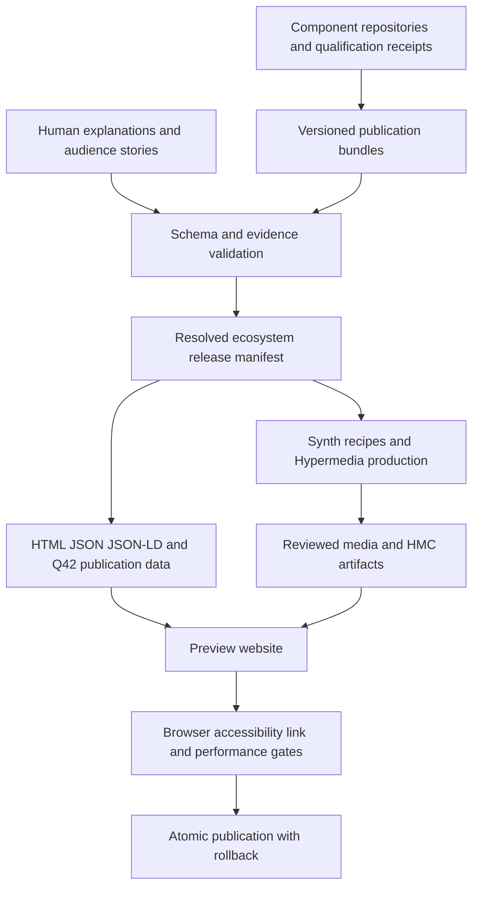

# Webizen ecosystem website renewal plan

**Implementation dispatch:** the [16 November swarm plan](../swarm/SWARM-IMPLEMENTATION-PLAN.md) and [work-package ledger](../swarm/work-packages.json) now control delivery sequencing, Infosphere Lab preservation and en-AU defaults. This renewal document remains the broader source brief.

Planning baseline refreshed: 16 November 2026, Australia/Sydney. The original 13 November plan is retained in `history/2026-11-13/`. Intended destination: the next major Webizen website, currently sourced from QualiaDB `docs/` and published for main versions at webizen.au. This is a planning and local design-review deliverable; the existing public website has not been changed or published.

## 0. Controlling brief after design review

**Working umbrella: human-centric computing, grounded in the natural world.** The web and internet ecosystem are part of this wider scope, alongside devices, AI, applications, creativity and scientific computation. Final public wording remains part of design review.

**Overhaul the entire website around a human-centric computing ecosystem, grounded in the natural world and its intersection with the infosphere.** Physics, nature, the biosphere, biology, sociology and the liberal arts are primary subject matter. People create, communicate, learn, care, cooperate and exercise agency within that world; the technology supports those activities.

The intended experience is an original explorable world with cinematic environments, authored scenes and titles, spatial storytelling, meaningful effects and actual technical demonstrations. Environments must be characterised by the natural, human and technological subjects they reveal. The complete site also needs excellent conventional pages, direct technical navigation, search, accessible equivalents and audience-specific routes.

**The first three local scene studies were rejected by the user.** Their sparse platforms, generic monuments and prototype rendering do not meet the required visual or technical standard. They are design history, not the implementation foundation. See the controlling [world design brief](../WORLD-DESIGN-BRIEF.md) for the natural/social/cultural world structure, concrete interactions, acceptance gates and next review requirements.

Use **`webizen-website`**, now initialised locally at `C:\github\webizen-website`, as the dedicated website repository. No remote or deployment has been created. Component repositories continue to own their implementations, normative documents, workloads and release evidence.

**Approval sequence:** world/subject structure → art-direction boards and platform scene blockouts → a visually reviewed vertical slice with real technical demonstrations → explicit user approval → whole-site implementation. Do not interpret viewing a mock-up as approval. Do not expand the rejected prototype into the full site.

The website's data model supports the experience backstage. Public copy starts from people, activities and questions; it must not sound like an automated progress report. Every core module must still explain what it does, why its approach is distinctive, why it matters, how it works with the ecosystem and what can be tried today.

The source inventory covers **202 HTML files**. Every public destination receives an explicit editorial, visual, interaction and technical-demo disposition. Reusable templates do not exempt pages from the overhaul. Preserve historical documents and identifiers with accurate archival treatment. All technical demos remain discoverable and owned; promotion requires actual runtime verification, not just a source listing.

### Human support, geometry and observer-relative experience

**Human rights principles, purposes, needs and support requirements must be demonstrated through actual behaviour throughout the ecosystem.** Positive assistance, accessible participation, bounded delegation, correction, contestability and practical agency are first-class requirements. See [human-support demonstrations](../HUMAN-SUPPORT-DEMONSTRATIONS.md).

**Information, socioeconomic and knowledge geometry** organise the relationships among people, purposes, needs, sources, institutions, resources, technologies and natural/social/cultural places. The world must make those relationships and their consequences tangible, while keeping mathematical models, artistic explanations and measured observations accurately distinguished.

**The `.q42`/Vibe-backed website must support observer-relative paths.** Build on the existing `entity_view` observer, circumstance, representation-wing, rights-filter, attribution and projection concepts. Adapt sequencing, explanatory depth, scale, expressive form and useful next actions to purpose/context and stated support requirements; keep evidence consistent and navigation controllable. Presentation preference does not grant authority. See [observer-path architecture and acceptance](../OBSERVER-PATHS.md).

The next vertical slice must execute a positive support interaction, a real purpose/authority boundary, and a correction or contestability interaction. It must also demonstrate three synthetic observer contexts traversing the same graph/place, with stable identity across immersive and reading views and inspectable selection/execution evidence.

### Refreshed source and runtime evidence

Exact pushed commits were verified through the GitHub connector; see [publication evidence](publication-evidence-2026-11-16.json). This confirms source publication, not deployed-site qualification or blanket CI success.

| Repository | Confirmed source revision |
| --- | --- |
| Synth | `0d08884612f387685eb96e5ddd0a2085c1f1ff02` |
| Hypermedia production | `8321792cb700cdac90adf1b1ef8accdc039597f1` |
| QualiaDB | `7f6057a743937173260c1d62d670283214a1d09a` |
| Etalon | `057545fc14bc1202a167b9a76a8f82e246c1738f` |
| Anatomy | `43336d5ccdbdcabf0a30fc1a86bcb0cc2b12b4a0` |

The catalog and ontology now agree at **150 operations**, including biological subject calibration and mobility/fracture-risk evaluation. These are implemented capabilities; their use in a website still needs accurate domain scope, educational framing and evidence. The source audit registry now records 939 files, 8,997 functions and 69 modules (15 November generation).

The connected Synth MCP responds and produced original vector/PNG assets with strict replay verification, but its receipt identifies the 13 November review executable and a 148-operation catalog. A **fresh stdio MCP connection to the current `target-prod/debug/synth.exe` reports 150 and successfully produced a `.10d`/HMC with strict replay verification**. See [current-runtime verification](../../evidence/current-synth-mcp.json). This is a stale app connection/configuration, not a missing operation. The live MCP was not killed or overwritten. Binary identity must be part of future production receipts.

Seven newly tracked pages are source material for the overhaul: audio, vision, EMF/QAC showcase and architecture, Hypermedia studio, domain solvers and QBDL streaming. None is automatically an approved public experience. Current benchmark JSON was refreshed on 15 November; retain its measurements and conditions while improving methodology, presentation and additional workload coverage.

## 1. Recommended direction

Build a data-driven public home for the whole Webizen ecosystem, with QualiaDB as its semantic foundation, Synth as its reproducible media producer, Hypermedia as its production library suite, and Etalon as its execution, rendering, signal and sensing foundation. Make the website itself a clear demonstration of the architecture: inspectable knowledge, connected explanations, beautiful authored media, measured capabilities and useful choices for the visitor.

**Create a dedicated website repository, provisionally `webizen-website`.** Keep engine code, normative specifications, API documentation sources and benchmark implementations in their owning repositories. The website should consume versioned publication bundles from those repositories and own the public narrative, navigation, design system, curated demonstrations and deployment. An ecosystem-wide site should not require a QualiaDB engine release whenever an Aether explanation, Synth gallery or institutional briefing changes.

Every important element must answer five questions:

1. What does it do, in ordinary language?
2. What is distinctive about its approach, with evidence for comparisons?
3. Why does it matter to a human-centric web, AI and internet?
4. How does it work with the other elements?
5. What can I inspect, try, build or evaluate today?

Use a shared content graph to answer those questions across module pages, audience journeys, the ecosystem map, feature explorers, benchmark dashboards and machine-readable downloads. Produce visual assets from the same versioned data. Do not make a hand-maintained collection of impressive but disconnected demo pages the primary architecture.

After explicit design approval, the complete overhaul must include the explorable world, the corresponding accessible reading experience, all current public-page dispositions, a new homepage, a complete core-module atlas, all six audience routes, three outstanding end-to-end demonstrations, a repaired evidence and benchmark hub, a usable developer path, and preservation of existing public links. Subsequent releases expand the demonstration library and deepen specialist material.

Reading routes: [module coverage](#4-core-module-coverage-across-repositories), [repository strategy](#5-repository-strategy-and-publication-ownership), [data architecture](#6-data-architecture), [page migration](#7-site-structure-and-page-migration), [flagship experiences](#10-flagship-experiences), [benchmarks](#12-benchmark-and-evidence-renewal), [bug backlog](#13-bug-and-quality-backlog), and [delivery packages](#16-delivery-work-packages).

## 2. Evidence and present condition

### Baseline inspected

The companion [page inventory](page-inventory.csv) records **202 local HTML source files**, including public pages, historical material, a shared layout and generated anatomy previews. Every row has a proposed section, disposition, source hash and explicit static-review status. These are not 202 independently reviewed production experiences.

The reproducible [source audit](source-audit.json), produced by [audit_site.py](audit_site.py), records:

| Observation | Planning implication |
| --- | --- |
| 150 operation IDs in Hypermedia's actual `OPERATIONS` table | Build the capability explorer from the catalog, with 12 categories plus the corpus assembly operation. Eliminate copied counts. |
| 175 of 202 HTML sources have no explicit description meta tag; none has an explicit canonical link | Generate metadata centrally, then verify the built output. Jekyll may add metadata that is absent in raw sources. |
| 111 unresolved local-reference candidates and 23 fragment-review candidates | Triage against the generated site. These are not 134 confirmed live failures; Rustdoc and dynamic anchors need separate resolution. |
| No duplicate source IDs detected in the scanned HTML | Preserve this check, while separately checking the hydrated DOM. |
| Homepage advertises a 0.0.41 release but Windows/macOS installer URLs point to 0.0.40 | Drive the displayed version and download from the same artifact record; an older available installer must have its own accurate label. |
| `_config.yml` describes 0.0.40 while `menu.json` declares 0.0.41 | Separate website release, engine release, artifact release and module versions. |
| `progress-0.0.41.html` references `js/nav.js`, absent from the checked source tree | Repair or replace the reference after confirming generated-build behavior. |
| Many historical standards pages use a local `js/menu-loader.js` path that does not resolve in their source directory | Restore archival navigation or remove the faulty injection; preserve original standards identifiers. |
| A generated heart view references `../../web/demo-portal.js`, absent at the resolved copied location | Fix the package/import contract so imported previews do not depend on the producer's original directory layout. |
| `playground/living-world-showcase.html` is 9,264,006 source bytes | Establish page and asset budgets; distinguish raw inline size from compressed transfer size. Split gallery browsing from optional large assets. |
| Homepage starts a WASM badge load and probes `http://localhost:4242/health` | Move local-runtime discovery behind an explicit “Connect my local Webizen” action; show a useful normal website before loading an engine. |
| Synth's provenance count is now 150, but some revision metadata and README descriptions lag the current source/binary graph | Publication must validate descriptive metadata against the resolved source graph. Do not select versions from a stale prose field. |

All four existing documentation contract checks pass on the refreshed baseline: release-version consistency, QDNF pages, Vibe developer docs and anatomy mobile fallback. The previous rights-terminology failure is closed. See [verification results](verification-2026-11-16.json). These checks do not qualify the deployed site and still do not catch the homepage installer-label mismatch.

Command:

```powershell
node --test docs/tests/release-version-consistency.test.mjs docs/tests/qdnf-pages.test.mjs docs/tests/vibe-dev-docs.test.mjs docs/tests/anatomy-mobile-fallback.test.mjs
```

Published-site retrieval failed in the available web reader, and the browser inspection timed out. Consequently, this plan does not claim a live visual, accessibility, performance, HTTP-header or deployed-WASM audit. Those checks are explicit first-stage deliverables. The working tree contains unrelated ongoing work; the planning files do not alter it.

### Strengths to preserve

The current site already has shared navigation data, a broad demo collection, real browser workload runners, release pages, source identity checks, device diagnostics, and benchmark metadata that distinguishes some measured and reference results. `benchmark.html` explicitly declines to report native tensor or allocation results when no such workload ran. `benchmark-shared.js` labels historical competitor references. Retain and improve these safeguards.

The current Pages workflow already builds several WASM profiles and runs focused tests. Move responsibilities carefully rather than discarding working qualification. Existing Etalon/Qualia lifecycle evidence includes actual device-loss recovery and separate transport cases; surface these as scoped evidence instead of replacing them with general claims of reliability.

The workflow documents two publication paths: GitHub Pages for eligible non-main refs, and Cloudflare builds from `main` for webizen.au. It also generates Rustdoc and stages it under `docs/rustdoc` before Jekyll builds. That explains why source-only Rustdoc link candidates require built-output verification. Confirm the actual Cloudflare settings and live behavior separately; copying the GitHub Pages job alone would not migrate both delivery paths.

### Evidence hierarchy

Use runtime/build artifacts and reproducible receipts for availability claims; source and registries for implementation claims; maintained manuals for meaning and ownership; and plans for future intent. A README can explain a module without proving every described feature works in the published browser build. A test count proves only the tested revision and scope. A beautiful preview demonstrates visual output, not scientific validity or a finished application.

## 3. Human-centric narrative and audience journeys

### The main story

Suggested opening: **“Knowledge, AI and creative tools that work on your terms.”** Follow with a concrete explanation: Webizen brings together local knowledge, inspectable computation, creative production and governed cooperation, with capabilities available through different applications and runtimes.

Introduce a human situation before a technical noun. A person wants to retain their work, understand an AI result, share something under agreed conditions, or cooperate with others. Show the relevant mechanism, what it enables and the present boundary. Then offer the technical explanation.

Translate the central values into observable behavior:

| Principle | What the site should show |
| --- | --- |
| Human agency | A visitor chooses an action, sees its scope and can stop it; software instruments and network handles are not presented as the person. |
| Personal autonomy | Local execution and export where supported; explicit requirements when a host, account, device or service is needed. |
| Knowledge with context | A claim links to its source, interpretation, uncertainty and relevant agreements. Conflicting claims remain inspectable. |
| Accountable cooperation | A synthetic example shows who may do what, under which agreement, and how an outcome can be reviewed. |
| Creative independence | A finished work can expose its editable source, resources, provenance and reproduction path. |
| Interoperability | Show actual import/export paths and boundaries, including standards formats and native resource formats. |
| Inclusive access | The same idea is understandable through text, keyboard navigation and lightweight media as well as an advanced spatial view. |

Avoid making privacy, fidelity, compliance or performance conclusions from architecture alone. Explain mechanisms positively and state the scope alongside the claim. Use the ecosystem's established language of human dignity, agency, self-determination and human-centric systems; treat cryptographic identifiers precisely.

### Audience routes

| Audience | Entry experience | Questions to answer | Useful next step |
| --- | --- | --- | --- |
| Everyday people and families | A three-minute story about keeping, creating and sharing something meaningful | What can I do? Where is my information? What runs here? What must I install? | Try a small local demo or get a clearly labelled build. |
| Government and public services | Public-interest scenario with an architecture and evidence summary | Deployment control, interoperability, accessibility, operations, procurement readiness and evaluation boundaries | Download a capability brief and a pilot evaluation checklist. |
| UN-related, humanitarian and civil-society organisations | Human agency, knowledge provenance and multilingual cooperation story | Relevance to rights, inclusion, local capacity, community governance and resource-constrained settings | Explore the standards/rights map and a bounded collaboration scenario. |
| AI researchers, builders and AI agents | Searchable capabilities, execution profiles, typed examples and machine-readable evidence | What operations exist? Where do they execute? What are their budgets and authority boundaries? | Download a release catalog or reproduce a workload. |
| Developers and integrators | Choose a module, a host and a first working example | Ownership, dependencies, SDKs, formats, supported platforms and release compatibility | Complete a tested quickstart and inspect source. |
| Investors, funders and partners | Ecosystem map plus concrete outcomes and release evidence | What exists? What differentiates it? How is it licensed? What work creates the next useful milestone? | Read a public diligence pack and discuss a defined partnership. |

Audience routes are curated views of shared records, not six divergent copies of product truth. An optional audience choice changes depth and examples; it never hides essential limitations or alters benchmark facts. Institutional relevance must not imply UN endorsement, legal certification, deployed government adoption or market traction that has not been established.

## 4. Core module coverage across repositories

The module atlas must cover the platform, applications, authoring, execution, networking, semantic infrastructure and reference experiences. Repository ownership and audience-facing product identity are different dimensions: one repository can contain several core modules, and one experience can draw on several repositories.

### Repository and product matrix

| Element and inspected owner | What it does | Distinctive approach to explain | Why it matters in the ecosystem | Demonstration and evidence direction |
| --- | --- | --- | --- | --- |
| **QualiaDB** — `qualiaDB` | Stores and queries contextual knowledge; supplies logic, authority, codecs and scientific foundations | Compact NQuin representation, integrated graph/logic, bounded hot execution and native resource relationships | Gives knowledge and computation a common, inspectable foundation under human-controlled hosts | Query a sourced knowledge set; inspect context, rules, output and exported data. |
| **Webizen applications and runtime** — QualiaDB `webizen-*`, client/app-contract crates; separately referenced desktop/shell repos need ownership confirmation | Presents the human-facing environment and application lifecycle | Organises tools around human activity and authorised host capabilities | Turns the technical libraries into something people can use and control | A tested real task flow, with the exact application and platform identified. |
| **Poet** — application ownership to reconcile with existing `poet-app`, studio and authoring sources | Human-facing composition and editing of works | Editable source, semantic resources and host-controlled authoring | Makes creation understandable and recoverable by its author | Open, edit, save and reopen a real work; clearly distinguish browser and native paths. |
| **VibeScript** — language/ABI in QualiaDB; tools in `vibe-script` | Expresses checked computation, behaviour and production | Shared language contracts with explicit host capabilities; tooling distinct from the language engine | Makes repeatable work and inspectable automation available across hosts | Change a small `.vibe`, run within budget and inspect output; show tooling and host profiles separately. |
| **Synth** — `synth` | Produces and packages assets from VibeScript and retained resources | Source sessions, resource validation, strict replay and native HMC packaging | Keeps creative results connected to editable, reproducible origins | Source-to-work journey with previews, retained inputs, output hashes and HMC download. |
| **Hypermedia production** — `hypermedia-production` | Supplies the 150 catalog operations across media categories | Composable typed production operations backed by shared libraries | Enables many forms of expression through one connected production workflow | Searchable catalog and curated recipes spanning graphics, geometry, sound, documents and time. |
| **Etalon** — `etalon` | Provides execution, accelerator, rendering, signal, sensing and inference building blocks | Shared resource/device contracts, generated kernels and explicit backend qualification | Makes computation and perception useful on available hardware, with observable execution | Field, rendering and compute demos identifying the actual backend; sensing uses recordings first. |
| **Anvil** — `anvil` | Describes hardware capabilities and supplies GPU/NPU routing facts | Hardware facts are separated from QualiaDB's policy decisions | Lets hosts choose a suitable execution path without confusing capability with permission | Optional device-capability explanation with local-only diagnostics and a static sample. |
| **Aether** — `Aether` | Application framework and native UI integration | Reactive UI and spatial/native integration over ecosystem interfaces | Provides the application layer through which humans control the underlying tools | A verified native workflow and a component anatomy; publish integration qualification by revision. |
| **Chora** — `chora` | Embeddable web and spatial document engine | Library embedding, traditional-web compatibility and host-delegated services | Connects existing web content with human-controlled hosts | A real embedding example; compatibility results and supported profiles. |
| **Webizen Host** — `webizen-host` | Hosting, namespace, deployment and cooperative service work | Human-centric hosting architecture with semantic publishing and explicit stewardship | Extends local activity into shared infrastructure | Explain the hosting workflow and qualification matrix. Current README explicitly says the VPS product is not yet production-qualified. |
| **QDNF and identifier fabric** — QualiaDB network/identity modules, `qualia-peer`, host integration | Supplies networking, identifiers, routing and related authority mechanisms | Context and authority are part of network interaction | Supports cooperation without collapsing people into a login, address or platform account | Inspect a bounded two-node scenario and exact executed transport/conformance evidence. |
| **Web Civics namespace and semantic instruments** — `ns`, QualiaDB standards/ontologies, host namespace service | Publishes vocabularies, structured instruments and semantic meaning | Contextual, human-centric vocabularies and resolvable source relationships | Connects systems and institutions through shared, inspectable meanings | Explore an instrument, its source and its structured representation; preserve namespace URIs. |
| **Wellfare, cooperative and work-graph components** — QualiaDB `wellfare-core`, `qualia-cooperative-core`, `work-graph` | Supplies domain and cooperation primitives | Context, relationships and work are represented as structured, governed interactions | Connects technical mechanisms to care, participation and cooperation | Synthetic collaboration example. Confirm public spelling/brand independently of crate names. |
| **Anatomy** — `anatomy` plus QualiaDB anatomy import/viewer | Produces and presents human-welfare spatial assets | Authored `.vibe` and `.10d`/`.emf` members connected through HMC | Demonstrates explainable spatial knowledge and authored educational work | Curated reviewed models; current README calls the drop welfare schematics, not a validated atlas. |
| **Ecopunk and living-world work** — `ecopunk` plus QualiaDB simulation/geospatial owners | Supplies environmental and living-world experiences | Semantic, spatial and behavioural relationships in authored worlds | Makes environmental reasoning and complex interactions tangible | A bounded catchment/tree/terrain story with source, units and model scope. |

Repository links mentioned in sibling READMEs are discovery leads, not proof of current publication. The connector returned 404 for the referenced `mediaprophet/webizen-desktop`; record its public repository location as unresolved rather than removing Webizen desktop from scope. The local Aether qualification notes are newer than parts of its README. Reconcile those sources before writing “available now” copy. These are specific closure items for the first phase.

### Coverage inside large repositories

Give each group an owned capability collection beneath its parent module:

| Parent | Required collections |
| --- | --- |
| QualiaDB | Graph/storage/query and RDF interoperability; logic/modalities/SHACL; authority/privacy/identifiers; QDNF and peers; local inference integration; geometry/geospatial/simulation; audio/vision/scientific libraries; resource codecs; CLI/MCP/SDKs; client/application contracts; Webizen browser/native profiles; cooperation and work graph. |
| Etalon | Device/resources; shader/Forge compilation; tensor and inference contracts/kernels/model I/O; rendering/reconstruction/simulation; signal; sensing core/runtime and individual device/provider adapters; browser/native diagnostics and qualification. |
| Hypermedia | All twelve production categories and the cross-category corpus assembly operation; underlying crate ownership remains discoverable. |
| Aether and Chora | Application/UI/runtime lifecycle versus web/document compatibility; clearly separated native, embedded-web and browser support. |
| Webizen Host | Core, ingestion, namespace, DNS, sandbox, stewardship, CDN, economics and workbench; separate implementation from end-to-end product qualification. |
| VibeScript | Engine, ABI, standard-library catalog, SDK/host profiles, WASM, LSP/editor tools and agent integration. |

Generate a package inventory from each pinned workspace, including explicitly excluded packages and non-Cargo applications. Map every package to a public module, internal implementation detail or historical/external component. Require a rationale for exclusions. This gives “all core modules” a testable definition without forcing every internal crate into the primary navigation.

## 5. Repository strategy and publication ownership

### Options

| Option | Benefits | Costs | Recommendation |
| --- | --- | --- | --- |
| Keep everything in QualiaDB `docs/` | Existing deployment and relative links; minimal migration | Ecosystem narrative remains coupled to one engine; large media, benchmarks and API builds compete with editorial work | Useful transition source; not the long-term ownership model. |
| Dedicated website repo with versioned module exports | Independent editorial releases; clear public ownership; coherent cross-repo compatibility record | Requires publication contracts, migration map and artifact delivery | **Preferred.** |
| Independent site per repository only | Local ownership and release autonomy | Repeated design/navigation, inconsistent claims and no clear ecosystem story | Keep specialist module docs where useful, linked through the common atlas. |
| Full ecosystem monorepo | Unified checkout | Large organisational migration unrelated to improving the website | Not required for this programme. |

### What belongs where

The website owns audience copy, module profiles, story relationships, visual language, page templates, navigation, curated recipes, search, URL mappings and release manifests. Each component repository owns normative specifications, implementation, API docs sources, benchmark workloads, correctness fixtures, capability exports and release-specific evidence. A module maintainer exports facts; the website editor writes the human explanation. Machine-generated counts do not write their own significance.

Existing module sites such as Etalon's remain useful specialist destinations. Ingest a concise validated profile, avoid copying entire manuals, and link to the corresponding immutable/versioned reference. Namespace documents in `ns` retain their own identifier and content-negotiation contracts.

### Proposed website layout

```text
webizen-website/
  content/                 # human-edited explanations and audience stories
  data/modules/            # module identities, ownership and narrative fields
  data/relationships/      # typed connections and human-benefit mappings
  schemas/                 # content, evidence, benchmark and release schemas
  imports/                 # validated module exports or content-addressed indexes
  releases/                # immutable ecosystem publication manifests
  recipes/                 # site-owned VibeScript visual/demo sources
  asset-manifests/         # HMC/member/preview references and production receipts
  site/                    # semantic HTML, styling and optional interaction adapters
  tests/                   # content, links, browser journeys and publication gates
  tooling/                 # import, validate, compile, render and verify
  migration/               # old-to-new routes and archive classifications
```

Large WASM, model, HMC and image variants belong in immutable release/artifact storage with checksums, not repeated history-heavy copies in every repo. Choose storage after measuring actual sizes, retention, range-request needs and hosting cost. Keep a small offline sample bundle for constrained audiences.

### Migration sequence

1. Snapshot the current published routes and source inventory; establish the exact live hosting/deployment path for webizen.au, including headers and rollback controls.
2. Create the website repo during implementation, with its own ownership, licence notices and CI. Start by importing the existing shell and a minimum data contract; avoid a framework rewrite as a prerequisite.
3. Export approved component data and immutable assets. Keep QualiaDB's technical documentation and tests functioning.
4. Build the new site at a preview origin. Test both domain-root and `/qualiaDB/` deployments because both patterns exist in current configuration.
5. Migrate a vertical slice and then all current navigation destinations. Maintain a route table with old URL, new URL, fragment handling, content owner and disposition.
6. Promote a tested site manifest. Keep the previous complete manifest and assets available for atomic rollback.
7. Leave redirects or explanatory archive pages in the old location. Remove duplicated website ownership only after link and release consumers have migrated.

Do not move DNS, delete existing docs or invent a new repository during this planning task. These become concrete implementation changes with an inspectable preview and migration report.

## 6. Data architecture

### A shared content graph with static publication

Author concise narrative in repository text files and structured records. Validate and compile them with imported component facts into a publication graph. Export semantic HTML, compact JSON indexes, JSON-LD and a QualiaDB `.q42` representation using existing codecs. Use the same identifiers and release selection in every representation.

The normal website can be served statically. It should not need a daemon, database request, GPU or model download to explain the ecosystem. Offer an optional “Explore this site as a knowledge graph” experience using QualiaDB's browser profile, with a small public data bundle and query examples. This directly demonstrates the technology without making it a barrier to reading.

Keep a single authoring authority for each field. For example, a repository exporter owns operation IDs and signatures; an editor owns the plain-language explanation; a qualification receipt owns an executed test result. The Q42/JSON/HTML outputs are generated representations of these sources, not competing editable databases.

### Core records

| Record | Essential fields and relationships |
| --- | --- |
| Module | Stable ID, name, aliases, owner, repo/source locations, purpose, distinctive approach, human significance, dependencies, related modules, capability collections, audiences, licence references. |
| Capability | Canonical ID, implementation owner, description, input/output schema, supported execution profiles, limits, availability, evidence links, example recipes and relevant concepts. |
| Claim | Exact statement, scope, source revision, supporting/contradicting evidence, review date, reviewer role and publication status. |
| Relationship | Typed source/target and provenance: depends-on, implements, produces, consumes, demonstrates, supports-goal, derived-from or supersedes. |
| Release | Site release ID, channel, component revisions, resolved dependency identities, content revision, schema versions, artifact hashes and compatibility results. |
| Demo | Question answered, participating modules, input fixture, recipe, output assets, backend requirements, budgets, controls, fallback, caption/transcript, review receipt and runtime evidence. |
| Benchmark run | Workload, runner, source identities, dataset/model hashes, environment, timings, correctness results, status, raw samples, methodology and comparison group. |
| Artifact | Media/type, size, hash, immutable URL, source recipe, production/runtime identity, member relationships, licence/attribution, accessibility alternative and approval status. |
| Standard or instrument | Original issuer/source, version/date, normative/draft status, interpretation scope, mappings, implementation/conformance evidence and stable identifiers. |
| Audience journey | Need, ordered story steps, module/capability references, demonstrations, reading depth and next action. |
| Legacy route | Old path, target, fragment policy, archive status, canonical policy and regression test. |

Human-benefit links describe intended or evidenced contributions; they do not assert that a library enforces human rights by itself. An authority record describes a permitted software action; it does not encode a person's whole identity or worth.

### Availability and evidence are separate dimensions

Use a small readable availability vocabulary: **Try in browser**, **Runs in a native host**, **Requires a device/service**, **Implementation available**, **Planned**, **Archived**. Accompany it with qualification state: source inspected, automated checks passed, runtime exercised, visually reviewed, externally evaluated, or not yet qualified for the described use. These are facets, not a single misleading maturity percentage.

An implemented morphism without a website adapter is “implementation available; website demo planned.” A tested native implementation is not automatically “try in browser.” A library release called stable is not evidence that every product built on it is production-ready.

### Example of a capability record

Illustrative schema shape; evidence and artifact references below are placeholders, not existing receipts:

```json
{
  "id": "hypermedia.electromagnetics.render_spectral_slice",
  "owner": "hypermedia-production",
  "module_ids": ["synth", "hypermedia", "qualiadb", "etalon"],
  "summary": "Make a visible slice of a stored electromagnetic field.",
  "why_it_matters": "A preview remains connected to the field it explains.",
  "inputs": {"emf": "retained field resource", "axis": "schema-defined axis"},
  "outputs": ["RGBA image handle"],
  "availability": {"implementation": "available", "website_demo": "planned"},
  "evidence_refs": [],
  "demo_refs": ["planned-field-light-sound"],
  "source_ref": {"repository": "hypermedia-production", "commit": null},
  "publication_status": "draft"
}
```

Draft records may have unknown fields. Published claims requiring a revision or evidence must not. Schema validation checks referential integrity, allowed statuses and required fields; semantic validation checks that claims are supported by the right kind of evidence.

### Import and release flow



Component releases propose website import updates through CI pull requests. Validate inputs as data; do not execute arbitrary supplied HTML or commands. Pin repository revisions, artifact hashes, schema versions and resolved dependencies. Detect a mismatch between a provenance description and Cargo's actual resolved graph. A failed import retains the last valid site and reports which component update needs attention.

Build a change-impact view: when a capability or release changes, identify affected module pages, claims, demos, benchmarks and briefings. This is a practical use of the graph and the main defence against the current documentation drift.

## 7. Site structure and page migration

Use a short primary navigation: **Explore**, **Try**, **Build**, **Evidence**, **About**; add an obvious search and audience chooser. Expose modules and life-domain stories within Explore. Keep release history, diagnostics and detailed API sections out of the first-level menu while preserving direct access.

### Homepage composition

1. A plain-language purpose and two useful actions: explore a guided story or try a small example.
2. One restrained, authored interactive scene with a lightweight poster. No automatic engine/model download.
3. A human-scale example linking an action, the modules involved and the inspectable result.
4. A navigable ecosystem map with an equivalent structured list.
5. Audience entry cards showing outcomes, not only job titles.
6. Three featured demonstrations with truthful execution labels and size requirements.
7. A concise evidence strip generated from a selected publication manifest; never an unqualified wall of test counts.
8. Participation, current-release and principles links.

### Page-family plan

| Existing area | Target experience | Specific changes |
| --- | --- | --- |
| `index`, `advanced-features`, `release-matrix`, `network_webizen` | Ecosystem home and module atlas | Replace broad feature lists with relationships, human significance, execution status and concrete routes. |
| New module pages for Synth, Hypermedia, Etalon, Anvil, Aether, Chora and Host | One consistent module template | Explain what/why/how, owners, dependencies, examples, limitations and source-linked evidence. |
| `graph`, `ontology`, `wordnet`, `sparql-*`, RDF comparison | Knowledge studio | Start with a question; show input, graph, query, result and provenance together. Support text/table alternatives. |
| `logic-showcase`, `modalities-showcase`, semantics and neuro-symbolic | Reasoning explained | Explain disagreement, time, permissions and uncertainty through small scenarios; distinguish proof, rule and interpretation. |
| `values-credentials`, `semantic-instruments`, agreements, ledger, CML and DocuQuin | Agency and cooperation stories | Show actors, scopes, sources, revisions and human review. Use synthetic data and real executing paths where qualified. |
| `graphics`, `spatial`, `universe`, science pages | Worlds and computation | Replace disconnected controls with curated questions and observable outcomes; connect geology, ecology, geometry and semantic picking. |
| `design-studio`, `human-centric-authoring`, `prompt-precision`, `poet-app` | Creative production journey | Present Poet, Synth and Hypermedia as distinct cooperating elements; make source/edit/replay/export understandable. |
| `vibe/*`, RDF-to-Vibe and native bridge | Language and tooling centre | Reconcile engine/tool repo ownership, generate reference catalog, test examples by host profile, add short guided tutorials. |
| `edge-llm*`, online LLM, `llmdemo`, Forge and WASM pages | AI and execution centre | Show model/runtime/backend provenance, honest hardware requirements, optional download sizes, cancellation and cache controls. |
| `qdnf*`, bootstrap gateway, namespace material | Connected infrastructure centre | Explain network and identifier roles, status by protocol/transport, topology and failure behavior. Separate simulated illustrations from live networks. |
| Eight benchmark-family HTML files | Evidence hub with specialist runners | One methodology and result schema; distinct tabs for results, reproduce, run locally, hardware coverage and historical references. |
| `data-formats`, `integrity`, zero-heap | Formats and execution contracts | Show Q42/HMC/10D/M64/EMF/QAC/P64 relationships and real limits; distinguish hot-memory arenas, construction budgets, process RAM and VRAM. |
| API, manuals, API explorer, utility and phone-console pages | Developer centre | Search, version selection, validated commands, platform selectors and visible unsupported states; diagnostics remain identifiable. |
| Cost model, monetization, approved developers | Participation and sustainability | Current licence matrix, contribution routes, publicly supportable opportunity and development status. Retire unsupported economics assumptions. |
| Release/progress pages | Release archive and current release selector | Preserve historical claims as dated records; current module versions come from a manifest rather than a single ecosystem-wide number. |
| Standards and historical drafts | Standards library | Issuer, normative/draft state, implementation mappings, current superseding document, stable URLs and readable long-form layouts. |
| Anatomy previews and living-world showcase | Curated demonstration gallery | Review and promote chosen assets; keep working previews clearly labelled, searchable separately and out of default flagship promotion. |
| 404, shared navigation, search, footer | Coherent public shell | Useful recovery, no-JS navigation, canonical metadata, accessibility statement, licence/credits and contact routes. |

The CSV covers every discovered HTML source individually. During implementation add the exact target URL, owner, acceptance test and migration status to each row. Extend inventory to generated Markdown routes, fetch-loaded resources, service-worker caches and downloadable assets before cutover. File classification alone is not a migration acceptance test.

## 8. Module-page editorial standard

Every module page should have a short introduction, an example, an explanation and a verifiable technical layer:

1. **In one sentence:** a concrete verb and the thing acted upon.
2. **A useful example:** a human task and the observable result.
3. **How it works:** a readable diagram with named ownership boundaries.
4. **What is distinctive:** mechanisms and tradeoffs, with a scoped comparison when evidence exists.
5. **Why it matters:** connect the mechanism to agency, inspectability, interoperability, cooperation or creative control.
6. **How it connects:** producers, consumers, common formats and supported hosts.
7. **Try or inspect:** runnable example, precomputed walkthrough, source and output.
8. **Current state:** release, execution profiles, tested platforms, limits and next qualification milestone.
9. **Build with it:** a tested entry point, API reference and licence information.

For example, Synth's opening can say: “Synth turns a VibeScript recipe and its inputs into packaged creative work.” Explain that retained inputs, source revisions and replay make it possible to inspect and reproduce a result. Demonstrate a changed profile producing a changed object, then let the visitor inspect the recipe and download the work. The human significance is continued control over how the work was made and how it can be changed.

Etalon's opening should explain computation, rendering, signal and sensing rather than reduce it to graphics. Its broader direction does not mean every physical sensor, RF transmitter, model or backend is supported. A field visualisation can explain an important mechanism while identifying whether its input is synthesized, recorded or measured.

QualiaDB's page should explain why retaining meaning, context and rules alongside data can help people inspect knowledge and software decisions. Explain the 48-byte NQuin at the technical layer and its relation to dense resources. Do not imply that an entire model, image or scientific field fits into 48 bytes, or that the 42 MiB Sentinel arena is the total memory footprint of every application.

Use evidence to explain distinctions from conventional databases, graphics APIs, content tools and hosting systems. Avoid unsupported “first”, “best”, “universal”, “AAA” or blanket speed claims. A well-explained architectural tradeoff is more convincing than a superlative.

## 9. Visual and interaction direction

Aim for an editorial science museum and creative studio: clear typography, generous space, legible captions and a few excellent interactive works. Use a consistent material and colour system to connect related concepts, without requiring colour to understand meaning. Keep ordinary reading surfaces calm; dark, high-contrast canvases can frame media experiences.

The ecosystem map should be a useful information interface. Selecting a module reveals its purpose, related human goals, dependencies, available demos and evidence. Provide an ordered HTML list and keyboard controls for the same information. Filter by question, audience, execution environment or availability. Use spatial depth only when it expresses a real relationship; label conceptual layouts so distance is not mistaken for a metric.

Use Synth to produce module illustrations, coherent diagram assets, media posters, animated explanations, comparison frames and downloadable briefing material. Use Etalon/QualiaPortal for appropriate live rendering or computation after interaction. Keep navigation, forms, article text and accessibility structure as semantic HTML. Text rendered into an image or canvas must not become the only readable copy.

Start with a design spike using the current static delivery approach and ecosystem renderers. Select a new static-site build tool only if it materially improves data validation, templating, routing or maintenance. The public site must work in existing mainstream browsers; it should not depend on unfinished native application integration.

## 10. Flagship experiences

### A. Explore the ecosystem through one useful work

**Question:** How do all these parts work together?

Choose a small authored landscape or object. Show the input facts in QualiaDB, the `.vibe` recipe, the Hypermedia operations, the Synth-produced members and package, and the rendered result. Click a component to see what it does and why it matters. Offer “explain simply” and “show technical detail” views of the same record set.

The dependency graph comes from the release manifest, not a decorative animation. A precomputed asset can be explored immediately; native reproduction is a separate explicit action. Acceptance: a visitor can identify the role of each participating module, inspect provenance and obtain the source and output.

### B. From a recipe to a finished work

**Question:** Can I understand and change how this was made?

Use locus construction, loft/revolve/extrude, surface generation, UV handling, material baking and sealed `.10d` output for a visually strong object. Show a few reviewed source variants and their results. Add a timeline or turntable, then a source-to-output provenance panel and HMC export.

The hosted static page may switch among pre-produced variants. Only label an action “generate” when it executes the admitted operation in a supported runtime or explicitly connected local Synth. Acceptance: repeat a pinned production recipe twice and compare HMC SHA-256; visually review the object and its material from several views; verify actual reopen/import behavior.

### C. Observe the natural world through distinct physical and perceptual views

**Question:** What can light, sound, geometry and measurements tell us about a place, and how do we check the interpretation?

Stage this as an instrument within the natural-world environment. Use a qualified, bounded source dataset and actual supported render/signal operations. Preserve units, coordinate frames, timestamps, spectral scope, provenance and uncertainty as the visitor changes views. A visual or sonic interpretation is a mapping, not a replacement for the source.

Current source includes EMF v4-candidate and QAC v1-candidate families in the shared field envelope. `.emf` stores electromagnetic fields; `.qac` is independently typed acoustic/mechanical media; `.10d` carries geometry and relevant declarations. QAC is not merely an EMF sonification store. Do not describe all EMF as visible-band data or assume that every container/profile is available in every checked-in WASM build.

The current envelope uses structural/index/payload checks including BLAKE3 and CRC-32C; do not turn these into an unsupported semantic validation or authenticated range-proof claim. `compile_emf` rejects `interpretation` and `audio_tracks`; qualify the actual path used. Reconcile stale format prose against the selected producer and reader before publication.

Acceptance: validate the actual container profile and generated WASM exports; execute the supported views; inspect output; expose the original source and mapping; provide muted, static, textual and reduced-motion alternatives. The existing EMF/QAC showcase's illustrative reconstruction score must not be published as measured solver accuracy.

### D. Inspect a claim and an agreement

**Question:** What does accountable cooperation look like?

Use synthetic people/roles and a small claim set with source documents. Let the visitor inspect a proposed action, applicable rule, disagreement and result. Show the path from an instrument through its interpretation to an executable rule and a recorded decision. Distinguish the original instrument, project interpretation and software implementation.

Acceptance: inputs and rule execution are reproducible; changes have an explainable outcome; roles are not conflated with natural persons; the demo makes no claim of legal adjudication or institutional endorsement.

### E. Explore a living catchment

**Question:** How can spatial knowledge help people understand a place?

Combine bounded terrain, vegetation, water-related data and semantic inspection in a curated environmental scene. Use the existing geodesy, manifold, kinetics and graph capabilities; map each control to a stated model and unit. Show the data source and uncertainty. Promote this after A–C unless a suitable reviewed Ecopunk scene already exists.

Acceptance: every control has meaningful behavior, numerical assumptions are visible, camera views communicate the phenomena, and the result is described at its actual scientific level. Terrain sculpting is a 2.5D heightfield, not a general volumetric terrain claim.

### F. Understand execution on this device

**Question:** Which capabilities can my device actually use?

Offer opt-in Anvil/Etalon diagnostics, explain selected backend and supported limits, and run a bounded computation with a correctness check. Keep device details local by default. Separate a successful capability probe from successful workload execution and from a performance result.

Acceptance: unsupported hardware still receives a clear explanation; cancellation and device loss recover; exact conditions accompany results; private device details are not automatically uploaded.

## 11. Coverage of the production catalog

Use the complete catalog for discovery and a smaller set of polished recipes for public demonstrations. A searchable operation page should expose arguments, limits, examples, executing hosts, source owner and generated previews. It is not necessary to put 150 controls on the homepage.

| Category | Verified catalog count | Website production use |
| --- | ---: | --- |
| Locus | 15 | Crisp source-driven diagrams, profiles, paths and geographic outlines. |
| Manifold | 27 | Authored objects, spatial scenes, cutaways, controlled mesh edits and interchange. |
| Surface | 8 | Coherent materials, UV previews, normal/AO maps and PBR examples. |
| Radiance | 30 | Posters, composition, grading, layers, motion effects and image asset variants. |
| Glyph | 7 | Diagram labels and production typography; HTML remains the accessible reading layer. |
| Layout | 10 | Visual layouts, nodegraph explanations, paged material and meaningful spatial interfaces. |
| Kinetics | 16 | Motion explanations, animation, simulations and reproducible sequence examples. |
| Acoustics | 9 | Optional sound design, spatial audio and signal examples with user-started playback. |
| Electromagnetics | 6 | Field synthesis, verification, spectral preview and clearly scoped sensing illustrations. |
| Geodesy | 7 | Terrain, native spatial resources and place-based stories. |
| Discourse | 9 | Reviewed galleries, charts, explanatory documents and presentation exports. |
| Chronicle | 5 | Recorded walkthroughs, synchronized sequences and time-based evidence. |
| Corpus assembly | 1 | Explain the cross-category corpus packaging operation separately from the twelve categories. |
| **Total** | **150** | Generate this table from the selected catalog during implementation. |

Existing caps belong in capability data: for example, loft section limits, Catmull–Clark level/triangle bounds, typical raster dimensions, botanical growth scope and field dense-volume bounds. They help recipe design and prevent a website control from promising an arbitrary workload.

Recognisable anatomy requires authored parts and reviewed geometry. The comparative vertebrate ellipsoid operation is not an anatomical organ modeller. Similarly, catalogue existence should not be mistaken for a finished specialist product; it is the basis for composing a good demonstration.

### Asset production and acceptance

Each promoted asset needs its recipe, retained input manifest, licences, exact producer/dependency identities, resource budget, production receipt, output hashes and visual-review record. Retain native members as well as browser-friendly derivatives. Use unique create-only output paths under the approved `target-prod` workflow; do not rebuild into or stop the live MCP instance.

Review exported PNG/SVG and front, side and three-quarter mesh views. Review anatomy project annotations before modifying models. Check that textures, silhouettes, scale, labels and camera composition communicate the intended object. A successful produce command, triangle count or HTTP 200 is not visual acceptance.

Separate byte-deterministic native outputs from backend-dependent rendered pixels. Require deterministic HMC reproduction for admitted recipes; use appropriate visual tolerances and recorded backend identity for GPU screenshots. Store large media externally with immutable identifiers. A homepage poster need not inline the full HMC, field volume and all previews.

## 12. Benchmark and evidence renewal

### What to improve first

Consolidate the entry points while retaining the useful underlying runners. `comparative_benchmark_results.json` currently identifies a synthetic graph dataset, daemon HTTP measurement, sample counts, warmups and engine version. `llm_benchmark_results.json` actually contains a broader native platform suite and marks competitor values as historical references. Preserve this provenance and rename or adapt the ambiguous source through a migration layer.

The comparative JSON was refreshed on 15 November 2026 at 14:32:56 UTC and the native platform suite at 14:32:48 UTC; both identify engine 0.0.41. Preserve these new measurements and their conditions. The latter still marks comparisons as not apples-to-apples. Add raw-run and source/binary identities and new media/field/streaming workloads rather than implying that a documentation update itself improves performance.

The benchmark experience should answer “what ran, how, where, whether it was correct, and what can reasonably be compared.” It should show improvement over the ecosystem's own previous revisions before emphasising competitors. Comparative claims become useful when workload, output, measurement boundary and environment are aligned.

### Benchmark families

| Family | Workloads | Measures and correctness gates |
| --- | --- | --- |
| Knowledge/storage | Point and multi-hop queries, SPARQL forms, ingest, indexes, cold-open, streaming and compressed resources | Correct result sets, bytes transferred, time-to-first-result, latency distributions, throughput, RSS and dataset identity. |
| Logic/governance | SHACL, modalities, rule evaluation, permitted/refused operations and bounded failure | Expected verdicts, work size, latency, allocation class and authority overhead. |
| VibeScript | Parse/check/compile, interpreted/bytecode profiles, host calls and complete small tasks | Same computation and output as comparison, warmup/JIT treatment, invocation and marshalling boundaries. |
| Synth/Hypermedia | Geometry operations, UV/material pipelines, raster, sound, documents and end-to-end HMC production | Validity and quality checks, deterministic replay, output bytes, wall time, peak memory and cancellation. |
| Etalon compute | Forge compilation, tensor kernels, inference primitives and resource transfer | Oracle agreement and tolerances, device timings versus wall time, precision, transfer cost and selected backend. |
| Rendering | Scene load, first meaningful frame, stable interaction, picking and device recovery | Frame-time distributions, scene/viewport identity, visual correctness, memory, device-loss recovery and fallback. |
| Local AI | Model load, cold/warm TTFT, prefill, decode and complete task latency | Identical model/tokenizer/quantization/context where comparison allows; actual token counts, output validity and memory. |
| Network/hosting | Resolve, connect, stream, cancel, reconnect and bounded contention | Real topology/transport, bytes, integrity, latency, resource use and failure semantics; separate simulated from executed paths. |
| Scientific/sensing | Small defined numerical workloads and recorded/live sensor processing | Units, input identity, tolerances or residuals, uncertainty, hardware/calibration and quality measures. |
| Website experience | Initial reading, first demo interaction, module discovery and asset load | Transfer bytes, rendering/interaction times, errors, accessibility and task completion across device classes. |

### Result schema and comparison policy

Record a unique run ID; component commits and dirty/source-capture status; resolved dependency identities; build flags/toolchains; workload version; dataset/model and licence; input/output hashes; seed; OS/browser/CPU/GPU/driver/backend; relevant power state; warmups; samples; timing unit; timer resolution; percentiles; raw samples; correctness results; memory method; and exact run command.

Statuses must distinguish passed, failed, unsupported, not run, timed out, cancelled and invalid. Missing numbers are not zero. A failed operation cannot become a speedup because its duration is short. Resource exhaustion and timeout remain visible, with their budgets.

Use comparison groups that lock workload semantics, dataset, expected output and measurement boundary. Do not rank an in-process lookup against HTTP SPARQL without explicitly showing the overhead and calling it a different comparison. Do not combine reference values with same-machine results into a leaderboard. If a valid relative comparison is unavailable, present separate measured results.

For small timings, batch operations and report timer overhead. For noisy workloads, retain independent repetitions and explain dispersion; do not imply strong p99 precision from a handful of samples. Separate cold load, warm cache, compilation, upload, execution and readback. Report energy only when measured with a stated instrument and method.

Benchmark graphics should be generated from result data, with accessible HTML tables and raw JSON/CSV downloads. A Synth-produced explanatory animation may illustrate the method, but it must not supply numbers. Use sparse, readable charts; select only commensurable series and expose axes, units and logarithmic scales.

### Execution programme

Maintain distinct CI correctness, controlled CPU, controlled GPU, browser-device and opt-in community result lanes. Pin competitor/runtime versions and preserve setup details. Hosted shared runners are useful for regression signals, but noisy observations need confirmation before a public performance conclusion.

Initial proposed regression alerts: a reproducible material slowdown against the same hardware/workload baseline, a correctness failure, a memory-budget breach, or changed output. Establish numerical thresholds from baseline variance rather than choosing an attractive universal percentage. Benchmark qualification and media-quality acceptance remain separate gates.

Publish a hardware coverage matrix including tested, unsupported and not exercised states. An NPU capability slot does not establish real NPU execution. A passed native test does not qualify browser/mobile performance. Preserve historical results and make the selected release/date obvious.

## 13. Bug and quality backlog

Priority P0 means fix before promoting the new public release; P1 means part of the major renewal; P2 means a later improvement. “Source-confirmed” refers to this checkout, not the deployed site.

| ID | Priority and evidence | Work item | Acceptance |
| --- | --- | --- | --- |
| SITE-01 | P0, source-confirmed | Reconcile release labels, actual installers, config and module versions | Every download label matches the artifact's manifest and qualified platform; stale artifacts remain accurately identified. |
| SITE-02 | Closed on 16 November | Previous rights-terminology assertion now passes | Retain the QDNF page contract check and accurate historical attribution. |
| SITE-03 | P0, unresolved source references | Repair current release navigation and imported heart-view script packaging | Built and deployed paths load; browser console and intended interaction are verified. |
| SITE-04 | P1, static candidates | Classify all 111 local-reference and 23 anchor candidates | Each is fixed, resolved by generated content, redirected or documented as intentionally archival. |
| SITE-05 | P0, deployment risk requiring live check | Audit root/subpath routing, WASM MIME, isolation headers, external resources and service workers | Target hosting serves the intended headers; demos run with correct `crossOriginIsolated` state where required; fresh and upgraded caches work. |
| SITE-06 | P1, source-confirmed behavior | Remove automatic homepage local-daemon probing and eager engine badge initialization | Reading requires no local service; runtime connection is explicit and has understandable timeout/retry states. |
| SITE-07 | P1, source-confirmed payload | Split large gallery shells from optional assets | Initial useful page meets its budget; assets load on demand with progress, cancellation and fallbacks. |
| SITE-08 | P0, benchmark publication rule | Preserve measured/reference separation and implement comparison eligibility | No unsupported speedup or fake zero; correctness, scope and environment accompany all ranked results. |
| SITE-09 | P1, source metadata observations | Generate descriptions, canonical links, sitemap, structured data and search index | Validate built metadata and indexing policy across public, archive, diagnostic and preview routes. |
| SITE-10 | P1, manifest drift | Replace copied counts/version facts with validated imports | Catalog count and IDs reconcile; source and binary/package identity differences are visible. |
| SITE-11 | P1, runtime verification pending | Test all promoted WASM/Portal/LLM journeys for loader, module, GPU and network failures | Recovery, cancellation, cache reset, fallback and no-capability states are demonstrably usable. |
| SITE-12 | P1, review required | Audit keyboard, focus, contrast, reduced motion, zoom, touch targets and screen-reader flows | WCAG 2.2 AA target checked with automated and manual methods; no canvas-only essential content. |
| SITE-13 | P1, editorial drift | Reconcile component ownership, memory claims, Etalon scope and native/browser maturity | Each important claim links to a source, profile and evidence status; no blanket ecosystem maturity badge. |
| SITE-14 | P1, content coverage | Refresh API/manual/standards indexes and public links | Generated docs and local source match selected releases; dated drafts remain recognisable. |
| SITE-15 | P1, integration risk | Validate data rendering and embedded asset boundaries | Untrusted labels are escaped, HTML is sanitized where admitted, URLs constrained, and embeds have appropriate policies. |
| SITE-16 | P2, content expansion | Add further specialist demos and translations | Each meets the same evidence, visual, accessibility and publication contracts. |

| SITE-17 | P0, source-confirmed misleading metric | Replace the EMF/QAC showcase's illustrative reconstruction RMSE/quality formula with a real validated solver result, or remove/clearly label it | No invented quantitative accuracy is presented as a measurement. |
| SITE-18 | P0, source-format drift | Reconcile EMF/QAC legacy prose, current envelope/profile versions and generated contracts | Producer, reader, specification and public example identify the same qualified profile. |
| SITE-19 | P0 before promoting field demos | Qualify generated QualiaPortal WASM exports and actual EMF/QAC reader journeys | Required exports exist in the deployed artifact and real input loads/rendering pass. |
| SITE-20 | P1, effective dependency drift | Record Cargo pins, local patch overrides, effective source and producing binary hashes | Website receipts identify what actually ran; copied provenance metadata cannot override effective dependencies. |
| SITE-21 | P0 design acceptance | Replace the rejected flat world studies with reviewed natural-world/infosphere environments and real demos | User approves the vertical slice; comparison with the current site's best experiences demonstrates a clear improvement. |

Current `_headers` contains isolation policies for selected HTML/routes and immutable caching rules for some unversioned filenames. Inspect what the actual host applies before declaring behavior. Adopt hashed/versioned asset URLs and revalidation for mutable manifests. Test HTML, JavaScript and WASM responses, external fonts/images, worker bootstraps and recovery from stale service workers. Studio serving requirements in Synth's contract also need to remain correct; a static host must have its own verified equivalent.

## 14. Accessibility, performance and trust

Adopt **WCAG 2.2 AA as the implementation target**, with keyboard and screen-reader review of critical journeys. W3C's guidance covers dynamic content, multimedia and AI web interfaces; conformance requires meeting the relevant criteria, not merely running an automated checker. [W3C WCAG overview](https://www.w3.org/WAI/standards-guidelines/wcag/).

Provide text summaries, captions, transcripts, keyboard alternatives, visible focus and reduced-motion controls. Audio starts muted; interactive animation can pause. The ecosystem map and benchmark charts have meaningful non-canvas equivalents. Test content at narrow widths and high zoom. Translation should use stable content keys and a glossary; prioritise languages based on the actual communities and partnerships using the site.

Proposed engineering budgets, to validate during the first design spike:

| Surface | Initial budget |
| --- | --- |
| Reading homepage | At most 500 KiB compressed HTML/CSS/JS excluding a separately budgeted poster; no engine or model fetch before intent. |
| Homepage poster | At most 250 KiB for the initially selected responsive variant. |
| Reading-page JavaScript | At most 150 KiB compressed, with non-JS reading/navigation preserved. |
| First lightweight demo | Aim for a selected transfer bundle at or below 8 MiB compressed; larger experiences declare their size before loading. |
| User experience | Establish representative mobile/desktop baselines; target LCP ≤2.5 s, INP ≤200 ms and CLS ≤0.1 for the reading shell under the declared measurement method. |
| Heavy runtime | Explicit profile-specific CPU, memory, asset and timeout budgets; release resources on exit/cancel. |

These are proposed acceptance targets, not current measurements or guarantees across all networks. Use independent asset budgets for substantive scientific models. Disable continuous rendering when hidden or idle, prefer event-driven redraw, and bound concurrent GPU contexts. Distinguish a lightweight static alternative from a degraded live simulation.

The public site should load no personal data or model by surprise. Demonstrations use public or synthetic inputs. Device probing and local connections are explicit. Keep optional diagnostics local unless a visitor chooses to export/share a report. A public analytics plan should favour aggregate task outcomes over individual tracking.

Use current per-component licence and attribution records. The ecosystem has mixed and evolving terms; do not call all of it permissively licensed or freely commercially usable. The public investor/funder material should distinguish available licences, intended future rights mechanisms and unresolved commercial arrangements. Do not publish confidential financial or partner information through the general content graph.

## 15. Machine-readable and developer experience

Publish a release-pinned catalog for AI agents and developers with stable identifiers, module relationships, exact operation schemas, examples, runtime requirements, budgets, source URLs and qualification state. Make it downloadable without scraping the visual interface. Supply JSON/JSON-LD and the optional Q42 graph; expose human documentation and concise agent guidance from the same versioned records.

Provide examples answering:

- Which implemented operations produce geometry, images, audio or documents?
- Which can run in the selected browser build, and which require native Synth?
- Which module owns an API or format?
- What supports this performance claim, and how can I repeat the run?
- What changes between these two ecosystem publication manifests?
- Which demonstrations explain personal control or cooperation?

Generate a sitemap and an agent-oriented index; an `llms.txt`-style summary can be an optional discovery aid, not an authority or permission mechanism. Do not expose private resources simply because the site supports machine readers. Human-facing and machine-facing claims must use the same qualification data.

The developer centre needs four tested entry paths: use QualiaDB knowledge/query functions; author a VibeScript work; produce/export with Synth/Hypermedia; embed execution/rendering through the appropriate Etalon/Aether/Chora interfaces. Every quickstart identifies platform, selected release, dependencies, expected output and a recovery path. Source code and ordinary search should remain useful without a GPU.

## 16. Delivery work packages

Roles below describe responsibilities, not people already assigned. Effort ranges are initial planning estimates for the website programme; new engine features, domain-model research and external qualification are separate work.

| Package | Deliverables | Dependencies | Responsible roles | Exit gate | Indicative effort |
| --- | --- | --- | --- | --- | --- |
| W0 Baseline and ownership | Live deployment/visual audit, expanded asset/route inventory, module ownership closure, bug reproductions and benchmark inventory | Existing repositories and deployment access | Technical lead, module maintainers, designer | Known public surface, owner for every core module, reproducible high-priority issues | 4–7 person-days |
| W1 Data and publication foundation | Website repo, schemas, release manifest, import adapters, package-to-module mapping and static templates | W0 ownership decisions | Site engineer, data/ontology lead | One module update regenerates its page/map/catalog without copied facts | 8–14 person-days |
| W2 Whole-site editorial and design overhaul | Natural/social/cultural world narratives, all public page families, all core-module profiles, six audience journeys, shared navigation/search and design components | W1 schema; W0 user/visual baseline | Editor, designer, site engineer | Visitors can explain the purpose and relationships; reading works without heavy runtime | 10–18 person-days |
| W3 Approved world and technical experiences | Platform-produced environments and actual demonstrations A–F in their appropriate places, source and output downloads, posters, fallbacks, visual and runtime receipts | W1 manifest and renderer adapters | Synth producer, rendering engineer, editor | Reproducible production, reviewed visuals, accurate execution labels and usable fallback | 12–22 person-days |
| W4 Evidence and benchmark hub | Unified schema/adapters, historical labels, controlled baseline runs, comparison policy, charts/downloads and regression view | W0 harness inventory; W1 release model | Benchmark engineer, component maintainers | Every promoted number traceable and every comparison eligible | 10–20 person-days |
| W5 Migration and launch | Existing route dispositions, bug fixes, accessibility/performance checks, headers/caches, release preview and rollback exercise | W2–W4 and migrated core content | Site/QA engineer, editor, release owner | All P0 issues closed; critical journeys pass on target hosts/devices | 6–12 person-days |
| W6 Further depth | Experiences D–F, specialist content, translations, additional device and institutional evaluation | First substantial release | Relevant domain owners | Each new experience meets the same publication contract | Separately scoped |

**The original 50–93 person-day estimate is superseded by the expanded cinematic/natural-world scope.** Re-estimate after the approved platform vertical slice and full demo inventory. Every public route needs editorial, visual and interaction disposition; shared components can implement that consistently. Preserved archives retain integrity while gaining clear context and navigation. Art production, scene streaming, real technical integrations, benchmarks, accessibility and device qualification all require explicit work packages.

### First implementation slice

After the design gates in section 0, build an inhabited natural-world/infosphere slice using QualiaDB, Synth, Hypermedia and Etalon, connecting at least three genuine technical demonstrations. The following data checks support that slice:

1. Define their module/capability/release records and a small human-benefit relationship set.
2. Import the catalog and selected source identity; render four module pages and a simple ecosystem map.
3. Produce a small visually reviewed Synth work and its static fallback.
4. Bind one measured benchmark result with raw evidence and an accessible chart/table.
5. Demonstrate an update: change a source record, rebuild, and show every dependent view updating consistently.
6. Test at both URL bases and on a device without the advanced renderer.

This validates the data-first architecture and the visual production loop before expanding templates across all modules. Complete the full module atlas before describing the site as an ecosystem-wide release.

## 17. Release acceptance and ongoing maintenance

The human-support and observer-path acceptance criteria are mandatory, alongside artistic and technical quality. Labels or staged responses without actual behaviour do not meet the gate.

Release gates:

- The user has approved the natural-world/infosphere vertical slice; all public experiences meet its artistic, human and technical standard.
- The complete demo inventory has an owner, disposition, runtime profile and truthful verification status; none is silently omitted.
- Every core module has a purpose, distinction, human significance, relationships, owner, current status and next action.
- Every published module/capability/benchmark record resolves to its source and selected release; unresolved draft evidence cannot be promoted accidentally.
- All 150 catalog operations reconcile with the selected source registry; underlying implementation counts are dated and generated, not permanent marketing statistics.
- Homepage and primary navigation work without heavy runtime initialization; all six audience paths reach a useful outcome.
- At least three flagship experiences have visual, functional and accessibility review, bounded loading and honest execution labels.
- Benchmark results preserve correctness, environment, raw evidence, failed/unsupported states and fair comparison boundaries.
- Existing navigation URLs have explicit migration dispositions; generated docs, assets, fragments and root/subpath variants are checked.
- Current P0 items are resolved; critical paths pass on agreed desktop/mobile configurations and constrained/fallback modes.
- Deployment verifies content hashes, MIME, response headers, caches and rollback; domain promotion uses the already-tested artifact manifest.
- Licensing, credits, scientific scope, institutional wording and public participation material receive owner review.

Track useful outcomes: first useful demo completion, module discovery, quickstart success, successful reproduction, broken-link/error rate, median reading/demo payload and evidence freshness. Define baseline values before claiming improvement. For usability review, ask representative readers to explain what a module does, why it matters and what they can do next. Include ordinary readers and institutional audiences, not only the developers who built the system.

Assign a site editor/release owner plus one publication contact per module. A component release opens a website update proposal automatically; changes to ownership or normative claims require maintainer review. Run link/schema checks on every site change, browser smoke checks on relevant changes, controlled performance runs on relevant engine changes, and scheduled publication freshness review. These are implementation recommendations, not automations created by this planning work.

When a source release advances, mark older evidence with its actual revision. It can remain useful historical evidence without being silently presented as current. Keep an accessible changelog describing changes to both the software represented and the site itself.

## 18. Decisions to close during implementation

The recommended defaults are sufficient to begin the first slice. Resolve these against the actual repositories and deployment before publication:

| Decision | Recommended default | Closure evidence |
| --- | --- | --- |
| Website ownership | Dedicated `webizen-website` repository | Confirm organisation, maintainers, licence and hosting ownership. |
| Public brand | Webizen ecosystem, with QualiaDB clearly identified as the foundation | Review terminology across product/module owners and representative readers. |
| Desktop/Poet ownership | Explicit module records even where repository mapping is unresolved | Locate authoritative application sources, current qualified builds and public URLs. |
| Host platform | Preserve the current working deployment during migration | Verify actual webizen.au delivery/configuration; do not depend on unqualified Host VPS features. |
| Asset delivery | Immutable versioned artifacts with small reading-shell assets | Measure transfer, range support, storage/egress cost and retention. |
| Content format | Typed repository records plus human prose, compiled to HTML/JSON/JSON-LD/Q42 | Prove schema, round-trip identity and the update-impact demonstration. |
| Flagship selection | Ecosystem work, recipe-to-work, field/light/sound | Compare existing reviewed assets and actual runtime support at W0. |
| Technical framework | Reuse the current static delivery model for the first slice | Change only with a demonstrated routing, data or maintenance advantage. |
| Benchmark platforms | Controlled CPU plus representative integrated/discrete GPU and mobile browser coverage | Agree actual devices, runtime versions and repeatability procedures. |

## 19. Source register and audit reproduction

Primary local evidence used for this plan:

- [QualiaDB README](../../../qualiaDB/README.md), [workspace manifest](../../../qualiaDB/Cargo.toml), [agent contract](../../../qualiaDB/AGENTS.md), [homepage](../../../qualiaDB/docs/index.html), [site config](../../../qualiaDB/docs/_config.yml), [navigation data](../../../qualiaDB/docs/menu.json) and [directory index](../../../qualiaDB/docs/DIRECTORY_INDEX.md).
- [Pages workflow](../../../qualiaDB/.github/workflows/pages.yml), [benchmark workflow](../../../qualiaDB/.github/workflows/benchmarks.yml), [header configuration](../../../qualiaDB/docs/_headers), [redirect configuration](../../../qualiaDB/docs/_redirects) and [menu loader](../../../qualiaDB/docs/js/menu-loader.js).
- [Benchmark hub](../../../qualiaDB/docs/benchmark.html), [comparative results](../../../qualiaDB/docs/comparative_benchmark_results.json), [native platform result file](../../../qualiaDB/docs/llm_benchmark_results.json), [shared benchmark presentation](../../../qualiaDB/docs/js/benchmark-shared.js), [browser benchmark integration page](../../../qualiaDB/docs/benchmarks.html).
- [Etalon/Vibe qualification record](../../../qualiaDB/docs/testing-etalon-vibe.md), [inference migration record](../../../qualiaDB/docs/testing-inference-migration.md), [release test](../../../qualiaDB/docs/tests/release-version-consistency.test.mjs), [QDNF page test](../../../qualiaDB/docs/tests/qdnf-pages.test.mjs), [Vibe docs test](../../../qualiaDB/docs/tests/vibe-dev-docs.test.mjs), [anatomy fallback test](../../../qualiaDB/docs/tests/anatomy-mobile-fallback.test.mjs).
- Sibling repositories: `synth/README.md`, `synth/AGENTS.md`, `synth/provenance/current-dependencies.json`; `hypermedia-production/README.md`, `crates/asset-production-vibe/src/operations_catalog.rs`, `audit-docs/INDEX.md`, `FUNCTIONS.md` and its matching module registry; `etalon/README.md` and crate inventory; `anvil/README.md`; `Aether/README.md` and `notes/implementation/resume-host.md`; `chora/README.md`; `vibe-script/README.md`; `webizen-host/README.md`; `ns/README.md`; `ecopunk/README.md` and workspace manifest; `anatomy/README.md`.

Hypermedia's function registry is dated 15 November 2026 and reports 939 files, 8,997 functions and 69 modules. These are dated generated figures, not a fresh complete kernel audit. The 150-operation catalog and ontology were separately compared. Original vector/PNG media was produced through the older connected Synth MCP, and a fresh current MCP connection produced a .10d/HMC with strict replay. The first three browser-tested visual studies were rejected; neither their existence nor source availability establishes production visual quality.

To regenerate the static HTML inventory and local-reference candidates from the QualiaDB repository:

```powershell
python docs/plans/webizen-site-renewal-2026-11-13/audit_site.py
```

The script reads source and writes only `page-inventory.csv` and `source-audit.json` beside itself. It ignores its own planning directory, skips external URLs and recognises Markdown-backed `.html` routes. It does not execute JavaScript, build Jekyll/Rustdoc, inspect network responses or validate scientific/visual quality. Its findings are an implementation worklist, with source hashes for reconciling later changes.

This planning folder follows the repository's existing `plans/` ignore rule. The refreshed plan is also imported into the dedicated local `webizen-website` repository. It is not a published website document. The refreshed inventory contains 202 source routes and the catalog contains 150 unique operation IDs. Source inventory, browser-tested design prototypes and actual runtime qualification are distinct evidence classes.
